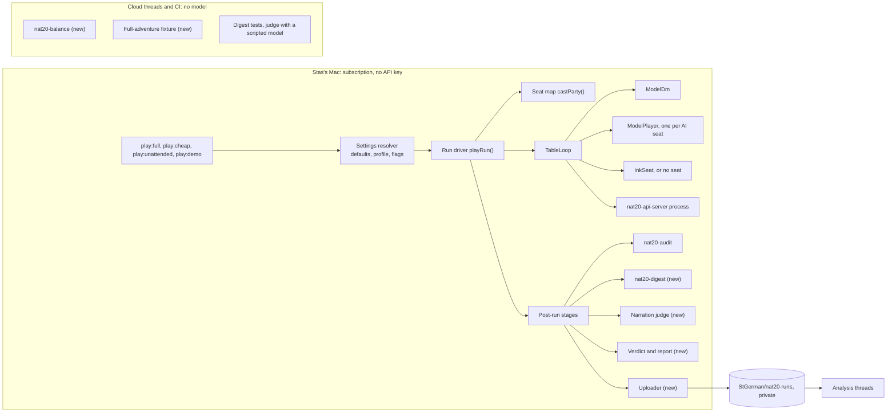
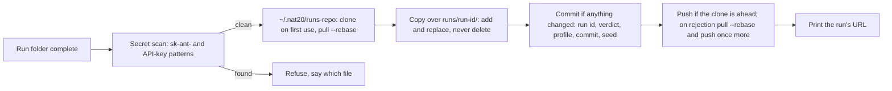

# Demo acceptance: system design (Milestone 7)

- **Status:** Agreed with Stas on 2026-10-27, with the [Milestone 7 spec](../milestones/milestone-7-demo-acceptance.md): the spec says what M7 must prove; this note says how the pieces are built and fit together.
- **Date:** 2026-10-27
- **Baseline:** table main 63e1f34, contract `1.0.0-dev.36`, core pin d00786a.
- **Decides:** the engineering choices in §5, each with what it rejected and when to revisit. Stas can overrule any of them.
- **Stas's decisions it builds on:** D1 to D5 in the spec, D4 (run models) and D5 (run profiles) accepted 2026-10-27 20:53Z. Nothing in this note needs another decision from him.
- **Rows:** every piece below folds into a `TASKS.md` row from the spec's §9 (§6 maps them). Decisions 0043 to 0045 record Stas's choices; the trade-offs in §5 are engineering calls this note makes.

## 1. Requirements

### 1.1 Functional

| # | The system must | Spec | Row |
|---|---|---|---|
| F1 | Play Scene 1 to Scene 6 in one process, the party carried, with a 120-minute stop | §3.1, §4.1 | AGT-14 |
| F2 | Run a table with no human: all four characters are AI players | §4.2 | AGT-40 |
| F3 | Let the human pick any character at the start of a terminal run | §4.2 | AGT-35 |
| F4 | Record what ran: build, settings and where each came from, seed, seats, per-scene timing | §4.1 | AGT-14 |
| F5 | Keep run settings in named, checked profiles | §4.1, D5 | AGT-14 |
| F6 | Judge each run against §3.2 and write a verdict: PASS, FAIL, VOID or PENDING | §3.2, §4.1 | AGT-14 |
| F7 | Check DM narration against engine state and inventory, with Opus at low effort as the judge | §4.3, D3 | AGT-9 |
| F8 | Let a move go as far as movement allows | §4.5 | API-35 |
| F9 | Measure fight balance over at least 100 seeds without a model | §4.4 | MON-10 |
| F10 | Replay the whole adventure with scripted agents in CI | §4.6 | AGT-39 |
| F11 | Push each run folder to the private runs repo | §4.9 | AGT-41 |

### 1.2 Non-functional

| # | Quality | Target | How it's measured |
|---|---|---|---|
| N1 | Run length | ≤ 120 min for Scene 1 to 6; projected 50 to 60 (spec §2) | `run.json` timing |
| N2 | Cost per full run | `cheap` about $5-6, `demo` about $11-14, judge about $0.5-1 (API-equivalent; plan usage on the subscription). Estimates: the 21-minute Russian run times 2.5 to 3 | `usage.jsonl` |
| N3 | Determinism | CI never calls a model; game fixtures replay byte for byte; an engine-log replay matches the recorded responses | Tests; the digest's replay check (§3.4) |
| N4 | Record integrity | No post-run step can lose or edit the run's record; every step can run again from the folder alone | Stage design (§3.3) |
| N5 | Privacy | Run records only in the private runs repo and the project folder, never in nat20-table or nat20; no secret leaves the Mac | Upload's secret scan (§3.8) |
| N6 | Visibility (Rule 3) | Unchanged: the leak scan passes per seat, a no-human table included | `nat20-audit` |
| N7 | Latency | Reported only (D1) | `usage.jsonl` |
| N8 | Operability | The unattended run needs no keystroke after the command; one line per scene shows progress; the last line gives the verdict and the run's URL | Terminal |

### 1.3 Constraints

- Live model runs happen only on Stas's Mac (Apple Silicon, Node 26.3.1) under his Claude subscription, with no API key (decision 0036). Remote Control is blocked, so a cloud thread can't start a run.
- One repo through M7 (spec §0). The engine wire changes only contract-first (Rule 1); API-35 is M7's only wire change.
- The engine rolls and resolves everything (Rule 4). Tools, the sweep driver and the judge never set an outcome.
- Run records never enter nat20-table or nat20 (`runs/` stays gitignored).

### 1.4 Assumptions

1. The engine is deterministic given its seed and request stream. Evidence: all 883 exit-run requests replayed with 0 divergences (TASKS.md API-35, 2026-10-27). §3.4 depends on it.
2. A full run folder is 7 to 10 MB (the 21-minute run is 2.3 MB). Plain git handles it.
3. A Russian DM narration averages about 210 characters; a full run has about 150 of them (53 in 21 minutes).
4. Haiku 5.5 supports `effort` low to max (checked against the current model docs), so `cheap` needs no code beyond the profile.

## 2. High-level design

### 2.1 Components



| Component | New or changed | Where | Row |
|---|---|---|---|
| Settings resolver, profiles | New | `game/src/play/settings.ts`, `game/profiles/*.json` | AGT-14 |
| Run driver `playRun()` | Changed: today's `scene.ts` body becomes a function that `play:scene`, `play:exit` and `play:full` share | `game/src/play/` | AGT-14 |
| Seat map `castParty()` | Changed: replaces `packParty()`'s fixed human | `game/src/play/run.ts` | AGT-40, AGT-35 |
| `TableState`, `TableLoop`, DM and player prompts | Changed: the human becomes optional | `game/src/table/`, `game/src/agents/` | AGT-40 |
| Character pick list | New | `game/src/ui/` | AGT-35 |
| `nat20-digest` | New Rust bin | `crates/nat20-duel/` | AGT-9 |
| Narration judge | New | `game/src/check/` | AGT-9 |
| Verdict, `runs:finish` | New | `game/src/play/verdict.ts` | AGT-14 |
| Uploader | New | `game/src/play/upload.ts` | AGT-41 |
| `move` with `partial` | Changed: contract, adapter, tools | contract crate, `adapter/game.rs`, `game/src/table/` | API-35 |
| `nat20-balance` | New Rust bin | `crates/nat20-duel/` | MON-10 |
| Chain DM and the full-adventure fixture | New | `game/src/table/scripted.ts`, `game/test/` | AGT-39 |

Unchanged: the engine apart from API-35, `nat20-audit` and the leak scan, the floor rules (decisions 0039, 0040), the Ink chat screen (decision 0041), the guards.

### 2.2 Where each piece runs

| Piece | Stas's Mac | Cloud thread | CI |
|---|---|---|---|
| The two M7 runs, the discovery run | Yes | | |
| Narration judge on a real run | Yes (it needs his plan) | | Scripted model only |
| Digest, verdict, audit | Yes, after each run | Yes, on any run folder | Tests |
| Balance sweep | | Yes | 2-seed smoke test |
| Full-adventure fixture | | Records it | Replays it |
| Run analysis (facts, analysis) | | Yes, from the runs repo | |

### 2.3 One run, end to end

```mermaid
sequenceDiagram
  autonumber
  actor Stas
  participant Full as play:full
  participant Loop as TableLoop
  participant Eng as Engine process
  participant Agents as DM and AI players
  participant Post as Post-run stages
  participant Runs as nat20-runs
  Stas->>Full: npm run play:unattended
  Full->>Full: resolve settings, preflight, caffeinate
  Full->>Eng: start with the seed; hello gives engine_rev and schema hash
  Full->>Full: write run.json (identity, settings, seat map)
  Full->>Loop: run Scene 1 to 6, deadline 120 min
  loop until the adventure ends, the deadline, a stall or a stop
    Loop->>Eng: awaiting and new events
    Loop->>Agents: wakes, each with its bound tools
    Agents->>Eng: commands through those tools
  end
  Loop-->>Full: RunReport with scene times and the stop cause
  Full->>Post: audit, digest, judge, verdict, report
  Post->>Runs: commit and push runs/run-id/
  Full-->>Stas: verdict line and the run's URL
```

### 2.4 Contracts touched

| Contract | Change | Rule |
|---|---|---|
| Engine wire | API-35 only: optional `partial` on `move`, `reached` on its result (§3.5) | Rule 1, contract-first PR |
| Transcript (TS writes, Rust reads) | Additive: `cause` on `fallback` records (`retries`, `timeout`, `error`, `unmapped`), and `prompt_id` on the human's `retry` records, needed for criterion 5 | Game type; the Rust reader ignores unknown fields |
| Scenario pack | Additive: optional `pronouns` on party entries (§3.4) | `pack:schema`, `pack:check` |
| Run folder | New files: `run.json`, `narration-digest.jsonl`, `narration-check.jsonl`, `confirmations.json`, `verdict.json` | Game records, `run_format: 1` |
| Seat (`TableEvent`, `PlayerIntent`) | None. The no-human table has no seat at all (§3.2) | The Telegram milestone's line stays as is |

## 3. Deep dives

### 3.1 Run driver and settings (AGT-14, D5)

**Settings.** One resolver serves every play command:
1. Built-in defaults (today's `parseArgs` defaults, moved into one object).
2. The profile, if `--profile` is given: a name loads `game/profiles/<name>.json`; a path loads that file.
3. Flags typed on the command line. `parseArgs` runs without defaults, so an absent flag is `undefined` and provenance is exact.

The resolver refuses an unknown key, a value outside its allowed set, and a model missing from the price table in `usage.ts`, before the engine starts. A `check:ts` test loads every committed profile. The result carries `{value, from: "default" | "profile" | "flag"}` per setting, and the profile's name and sha256.

**`run.json`**, written at the start and rewritten at the end, so a crash still leaves the identity behind:

```json
{
  "run_format": 1,
  "run_id": "full-2026-10-28T09-12-03-120Z",
  "command": "play:full",
  "profile": { "name": "cheap", "sha256": "…" },
  "settings": { "dm-model": { "value": "claude-sonnet-5-5", "from": "profile" } },
  "build": { "table_commit": "…", "dirty": false, "engine_rev": "…", "contract": "1.0.0-dev.37", "schema_sha256": "…", "node": "v26.3.1", "os": "darwin arm64" },
  "seed": 123456789,
  "seats": { "human": null, "ai": ["bren", "torva", "maren", "ilsa"] },
  "scenes": [{ "id": "s3_mill_yard", "target_minutes": 25, "started_at": "…", "ended_at": "…", "rounds": 6 }],
  "started_at": "…",
  "ended_at": "…",
  "ended": "the adventure ended",
  "stop": null
}
```

`engine_rev` and the schema hash come from the engine's own `hello`, not from the lockfile, so they name what actually ran. A dirty tree is recorded, and the verdict marks such a run as not eligible for acceptance.

**Stops.** `stop` is one of:

| Stop | Raised by | Verdict |
|---|---|---|
| `time_limit` | A 120-minute timer calls `table.end()`. The loop checks between decisions, so a wake in flight finishes or times out first (at most 45 s over, a player's combat turn) | FAIL, criterion 1 |
| `stalled` | 12 explore rounds in a row with no engine event besides turn and round bookkeeping (no check, move, scene load or fight). `--stall-rounds` overrides it | FAIL, criterion 1 ("a stuck scene") |
| `usage_limit` | `UsageLimitReached` (exists) | VOID |
| `login` | `LoginExpired`: a model turn's result says the Claude login is missing or expired. The message names the fix (run `claude` to sign in) | VOID |
| `offline` | A new error class, raised when 3 model wakes in a row fail with a connection error. It stops the run the way `UsageLimitReached` does | VOID |
| `operator` | Ctrl+C | VOID |
| `crash` | The engine stopped, or the loop threw | FAIL |

The stall rule turns a silent hour of talk into an early, named failure. It doesn't nudge the DM: pacing is AGT-12's job, built only if a run projects above 100 minutes.

**Sleep.** On macOS the driver starts `caffeinate -i -w <pid>`, so the Mac stays awake for exactly the run's life. The preflight warns when the Mac is on battery.

**Progress.** The unattended run prints one line when a scene starts or ends and when a fight ends: elapsed time, scene, rounds, the fight's outcome, retries and fallbacks so far. Nothing hidden reaches a player that way: the terminal isn't a seat, and Stas started the run.

### 3.2 Seat map: no human, or any human (AGT-40, AGT-35)

`castParty(pack, choice)` returns `{ human?: Handle; ai: Handle[]; cards; names }`, where `choice` is the pack's default (Bren), `none` (`--seat ai`), or a handle (the pick list, or `--play <handle>`). Every party member already has a card, so any of them can be an AI player.

**The human becomes optional in the type.** `TableState.human` and `TableState.seat` become optional, and the compiler lists every place that assumes a human (about 200 references across `loop.ts`, `state.ts`, `tools.ts` and `dm.ts`). Each gets one of three treatments:

| Treatment | Where | With no human |
|---|---|---|
| Skip | The human's screen: `show`, `flush`'s screen half, the situation panel, `/commands`, `inputs.jsonl` for the human | Nothing is shown; the transcript still writes the DM's view of every stretch |
| Route to an AI seat | `step()` already routes an awaited actor to its agent; the human branches are never taken | Unchanged |
| Change a rule | Out of combat, a round starts from the DM's last narration: `talkRound("")`, so only the DM's addresses name a player first. The DM gets no `ask_human` and is never woken to map words. A surrender is the DM's call (`end_combat` with surrender, as when the human's character is down today). Every seat's reaction to an ally is declined without a model call | The DM's prompt and the player prompt get their no-human variants |

**The pick list** shows before Ink takes the terminal: a numbered list of the party, each with name, species, class, level and the first line of the card's Goal, read from the pack and its pregens. The pick sets `choice`; the rest follows from the seat map, because the DM's prompt, the bindings, the leak scan and the auto-decline already key on the human's handle.

### 3.3 Post-run stages and the verdict (AGT-14)

After the loop, the driver runs five stages. Each reads the run folder, writes one artifact, and never edits another stage's file:

| Stage | Writes | On failure |
|---|---|---|
| Audit and leak scan (`nat20-audit`, exists) | Its output in `report.md` | Criterion 2 or the leak row FAILs |
| Digest (`nat20-digest`, §3.4) | `narration-digest.jsonl` | Criterion 3 PENDING; a replay divergence is a P0 engine row |
| Judge (§3.4) | `narration-check.jsonl` | Criterion 3 PENDING (a plan limit here doesn't void the run) |
| Verdict | `verdict.json`, the verdict block at the top of `report.md` | Never fails: it reports what's missing |
| Upload (§3.8) | Nothing in the folder | The run is kept; `runs:upload` sends it later |

`npm run runs:finish -- <run-dir>` runs whichever stages are missing, so a run cut off in the judge is finished later without a replay.

**The verdict is a pure function of the run folder.** `runs:verdict` can recompute it on the Mac or in a cloud thread:

| Row (spec §3.2) | Reads | FAIL when |
|---|---|---|
| 1 Time | `run.json` | Scene 6 not reached, or `stop` is `time_limit`, `stalled` or `crash` |
| 1a Party survives | Session log | Every party member down or dead at once |
| 2 Audit | Audit output | Any problem |
| 3 Narration | `narration-check.jsonl`, `confirmations.json` | A flag Stas confirmed. Flags not yet answered make it PENDING |
| 5 Retries | Transcript `fallback` records with `cause: "retries"`; the human's refusals per decision, grouped by `prompt_id`; `confirmations.json` | An AI player or DM fallback with `cause: "retries"`, or a human decision refused more than twice that Stas confirms (not yet answered: PENDING). Timeout fallbacks are latency (D1) and only reported |
| Leak scan | Audit output | Any leak |
| 4 Latency | `usage.jsonl` | Never: reported only |

The human is never cut off after two refusals; the loop keeps offering the choice. A refusal of the human's decision is a `retry` record with the human as speaker, or the DM's "didn't map the words" fallback (`cause: "unmapped"`, which is the human's refusal, not a DM failure). A human decision refused more than twice becomes a flag like a narration flag: Stas confirms it (the table failed him) or dismisses it (his own doing). Only Stas's run has a human, so these rows are empty in the unattended run.

VOID wins over FAIL (a cut-off run says nothing). `confirmations.json` maps each flag id to `confirmed` or `dismissed` with a note. Stas answers in a thread, the thread writes the file into the runs repo, and the verdict is recomputed there. No interactive tool is built for two runs.

### 3.4 Narration check (AGT-9, D3)

**Digest: replay, don't re-derive.** The session log can't rebuild state on its own: `scene_loaded` carries no positions, and starting HP and inventory live in the pack and the pregens. Rather than write a second state model, `nat20-digest` replays the run's `engine-log.jsonl` through an in-process `Server` (`Server::handle_line`, as `nat20-duel`'s client does), with the seed from the recorded `new_session`. After each request it compares the response's events (seq, kind, text) with the recorded ones and stops at the first divergence. Whenever the log reaches a DM narration's `log_head`, it asks the replayed engine for the DM view (`get_state`) and each party member's sheet, and writes one digest record:

- the line, its scene, mode, round and whose turn;
- every creature in the scene: side, HP and max, life state, conditions, position, surrendered or fled;
- pairs within 5 ft, and each party member's distance to the nearest foe, so the judge never does 3D arithmetic;
- the engine lines since the previous narration, `item_used` included;
- each party member's equipment and consumables with quantities, from the replayed sheet: in full on the first line of each judge batch, then only when they change; coins come from the pregen's `money`, since the engine doesn't track money and nothing in this adventure changes a purse;
- the party's names (the pack's `names`) and pronouns.

**Pronouns.** The English run called Torva "he" 17 times while her card says "she" (checked by hand on 2026-10-27). Cards carry no pronoun field, so the pack gets an optional `pronouns` on each party entry. The digest reads it, and the DM's prompt names it, which fixes the cause and not only the symptom.

**Judge.** A TS command (`npm run audit:narration -- <run-dir>`) built on the agents' session plumbing (`sdk-session.ts`): Opus 5.5 at low effort, no built-in tools, and one strict tool, `report`, that takes a list of `{line, claim, kind, evidence_seq}`. The kinds are HP, death, position, condition, action, surrender, inventory and identity. The judge reads 10 narration lines a call, with their digests, in a fresh session each time, so its context never grows; because each batch opens with the party's full inventory, a fresh session always has the baseline an inventory flag needs. The system prompt carries the rules from spec §4.3, including the three inventory flags and the untracked props that are listed, not flagged. A full run is about 15 calls. The judge isn't a seat: it has no game tool and its output reaches no agent.

**Calibration**, before the M7 runs:
- *Recall.* A scripted fixture with two planted contradictions, modelled on the two real ones: a narration that puts Bren next to a goblin 24 ft away, and a goblin narrated as surrendering that then shoots. The digest runs on it in CI. The judge runs on it on the Mac and must flag both. A planted fixture works on any build; the real M6 runs replay only if the current engine still answers their requests the same way.
- *Precision.* The three Milestone 6 runs checked by hand for inventory drift on 2026-10-27, if they still replay: any flag there is either a miss in that manual review or a false positive, and Stas sees the list.

CI tests the digest on the fixtures and the judge's plumbing with a scripted model that returns fixed flags.

### 3.5 Move as far as movement allows (API-35)

**No core change is needed.** Core's `movement::path` and `path_in_range_of_target` already take `allow_partial` and return a `taken_path` trimmed to the movement left. The adapter passes `false` today (`adapter/game.rs`, `move_to`).

Contract-first, in one PR:
1. `Command::Move` gains `partial: bool` (serde default `false`, skipped when false). Doc: with it, a route longer than the movement left is walked as far as movement allows; without it, the move is refused as now.
2. The `Move` result gains `reached: bool`: whether the creature ended where it was sent (next to the creature, or at the point or anchor).
3. Fixture `contract/fixtures/move_partial.jsonl`: the same far move refused without `partial`, and walked short with it.
4. `CHANGELOG.md`: `1.0.0-dev.37`, additive.
5. Adapter: pass `partial` as `allow_partial`, walk `taken_path`, set `reached`.
6. Game: the DM's and the players' `move` tools and the human's numbered move lines send `partial: true`, and the tool's answer says how far it went and how far is left. Without `reached`, an agent that came up short would attack, be refused, and spend a retry.

Opportunity Attacks along the shortened walk are core's, as for any move.

### 3.6 Balance sweep (MON-10)

`nat20-balance`, a Rust bin next to `nat20-duel`'s drivers, plays the fights' chain through an in-process `Server` and the contract's JSON lines, so it never touches core (Rule 5):
- **Chain:** Scene 2 (the snare and the lookout checks, which decide the yard's surprise), Scene 3 (yard fight), Scene 4 (short rest with Hit Point Dice, then the interrogation check), Scene 5 (cellar fight). The flags that change the fights, `party_ambushes` and `boss_warned`, come from rolled checks, and the engine decides the rats, so each seed reaches its own variant and nothing is forced (Rule 4).
- **Party policy:** attack the foe in reach with the least HP; Healing Word on a downed ally; a potion at a third of HP or less; Second Wind and Action Surge; Rage first. Movement toward the nearest foe with `partial` once API-35 lands. Monsters keep the engine's own policy.
- **Output:** per fight and per variant, the win rate, deaths, rounds, HP left and potions used, plus the share of seeds that reach Scene 6 standing (target ≥ 90%). It writes a Markdown table to stdout and JSON for a later re-check.
- **Cost:** about a second a seed in process, so 100 seeds take a few minutes in a cloud thread. A `cargo test` runs 2 seeds so the driver keeps working.

A tuning proposal goes to Stas only if the target is missed (spec §4.4).

### 3.7 Full-adventure fixture (AGT-39)

`walkOnDm` ends the adventure at the first fight's end. A `chainDm` variant loads the next scene at each scene's end, rests in Scene 4, starts each scene's fight, and ends the adventure after Scene 6. With `ScriptedPlayer`s and the scripted seat at a fixed seed, `loop.test.ts` records `m7_adventure.*` (transcript, session log, inputs), replays it byte for byte, and `game_fixtures.rs` audits and leak-scans it. Once AGT-40 lands, a second fixture plays it with no human, so the no-human paths have a byte-exact guard too.

### 3.8 Upload (AGT-41)



- Plain `git` with Stas's own login; no token in code or config. `NAT20_RUNS_REPO`, `--upload <repo>` and `--no-upload` as in spec §4.9.
- Idempotent: `runs:upload` copies the folder over the clone's copy, commits only if a file changed, and pushes whenever the clone is ahead of the remote. So it retries a push that failed, sends what `runs:finish` added after the first upload (the judge's flags, the recomputed verdict), sends old runs, and does nothing for a run that is already up to date. It never deletes, so a `confirmations.json` a thread wrote in the repo stays, and it recomputes `verdict.json` in the clone after the copy (`runs:verdict`), so a stale verdict from the Mac never overwrites the confirmed one.
- A failed upload never fails the run, and the folder stays in `runs/` either way.
- Threads read the repo after Stas adds it to the project. Analysis files keep going to the project folder, never to either code repo.

### 3.9 Where the first block plugs in

- **AGT-34 (R1 background reactions)** adds the first background wake inside a fight. The party-talk thread owns it; Stas settled its spec on 2026-10-27 (decision 0042, table #147): any AI player not acting next may react and the first line wins (its D1 = B), and a reaction shows the moment it is ready, before the DM narrates the trigger, outside the chat screen's hold (its D2 = B, an exception to decision 0041). Three points meet this design:
  - The 120-minute stop and the stall rule cancel a reaction in flight through the same `table.end()`, and the run waits for it to close before the stages start, as it does for every agent today.
  - A reaction is speech, so the narration judge doesn't read it. The audit still holds engine lines to log order for each listener; a spoken line between them doesn't change that.
  - The unattended run has no screen, so it exercises reactions but not when they show. Only Stas's run tests D2 = B, which is one more reason his run comes on the same commit.
- **AGT-38 (Russian names)** feeds the pack's `names`, which the digest passes to the judge, so name forms in Russian narration match their handles.

## 4. Load, cost and reliability

### 4.1 Load per full run

| Measure | 21-minute Russian run (Scenes 1, 3) | Full run, estimated |
|---|---|---|
| Engine requests | 744 | about 2,000 |
| DM narrations | 53 | about 150 |
| Model wakes | 95 | 250 to 300; a fourth AI player in the unattended run |
| Run folder | 2.3 MB | 7 to 10 MB |
| Judge calls | | about 15 |
| Digest replay | | seconds, in process |

Scale is one run at a time on one Mac, so the only load question is the runs repo: at about 10 MB a run it reaches 1 GB near 100 runs (§7).

### 4.2 Failure modes

| Failure | Detected by | Effect | Recovery |
|---|---|---|---|
| Plan usage limit during play | `UsageLimitReached` | VOID | Run again in a fresh usage window |
| Plan limit during the judge | Stage error | Criterion 3 PENDING | `runs:finish` later |
| Network down | 3 failed wakes in a row (`offline`) | VOID | Run again |
| Mac sleeps | Prevented by `caffeinate`; the preflight warns on battery | | |
| Engine crash | `EngineStopped` | FAIL; transcript and request log kept | A row from the crash |
| DM never moves the story on | Stall rule | FAIL, early | A row: prompt or pacing |
| DM timeout skips a narration | Existing fallback | Reported (latency) | Optimisation milestone |
| AI decision refused past its retries | `fallback` with `cause: "retries"` | FAIL, criterion 5 | A row; API-35 removes the known cause |
| Human decision refused more than twice | The human's `retry` records by `prompt_id` | A flag; FAIL, criterion 5, if Stas confirms it | A row on what refused it |
| Replay diverges in the digest | The digest's response check | Criterion 3 PENDING; nondeterminism | P0 engine row |
| Judge flags a false contradiction | Stas dismisses it | None | Prompt fix if it repeats |
| Push rejected or offline | git exit code | None | `runs:upload` |
| A secret in the folder | Upload's scan | Upload refused | Remove it, upload again |

### 4.3 What Stas sees

During a run: the Ink chat screen in his run; the progress lines in the unattended one. After it: one line with the verdict and the run's URL, and `report.md` with the verdict block on top, the timing table against `target_minutes`, the judge's flags marked "to confirm", and today's usage, latency and talk sections.

## 5. Trade-offs decided here

| # | Decision | Chosen | Rejected | Revisit when |
|---|---|---|---|---|
| T1 | State for the narration check | Replay the engine log in process | Fold events into a second state model (drift from the engine's own rules); a snapshot at each narration (a loop change, and no help for runs already taken) | Replays across builds keep diverging: then snapshot at write time |
| T2 | A table with no human | `human` optional in the type, so the compiler finds every assumption | A null seat that swallows calls (a wait on a seat that never answers hangs the run instead of failing to compile); a model behind the `Seat` interface (D2 rejected it, and it tests the word-mapping path, not AI players' tools) | The Telegram milestone puts a contract on the seat line |
| T3 | Balance sweep | A Rust driver in process | The TS loop with policy players: it waits for AGT-40, runs about ten times slower, and the loop doesn't change fight outcomes | The DM runs monster turns (AGT-23), so the loop does change fights |
| T4 | API-35 | A contract flag passed to core's own `allow_partial` | A core change (not needed); the table splitting a move into two requests (a workaround of a core rule, Rule 5) | Never, unless core changes its pathing API |
| T5 | The verdict | A pure function of the run folder, recomputable anywhere | A verdict computed once at the end of the run (lost on a crash; can't take Stas's confirmations) | |
| T6 | Judge sessions | A fresh session per batch of 10 | One session for the run (its context grows with every batch, and so do cost and drift) | Batches lose context a flag needs |
| T7 | Confirming flags | Stas answers in a thread; the thread writes `confirmations.json` | An interactive confirm tool (not worth building for two runs) | Friends-and-family runs make flags routine |
| T8 | Stall | Stop after 12 quiet explore rounds | Only the 120-minute stop (burns an hour of plan on a hang); nudging the DM (hides the defect M7 should find) | A legitimate scene trips it |
| T9 | Run settings (D5, accepted by Stas) | JSON profiles with provenance | A Makefile (a second command surface that can't check or record anything); one npm script per combination | |

## 6. Build order and rows

The spec's steps hold. This note adds where each piece goes:

| Step (spec §5) | PR | Pieces here | Row |
|---|---|---|---|
| 0 | No code: the discovery run on the baseline | | |
| 1 | `table/play-full` | §3.1 settings, profiles, `run.json`, stops, `caffeinate`, progress; §3.3 stages and verdict; `cause` on fallbacks | AGT-14 |
| 1 | `table/run-upload` | §3.8 | AGT-41 |
| 2 | `table/adventure-fixture` | §3.7 | AGT-39 |
| 3 | `table/balance-sweep` | §3.6; its measurement goes to the MON-10 row | MON-10 |
| 4 | `table/move-partial` | §3.5, the only contract change | API-35 |
| 5 | `table/no-human-table`, then `table/pick-character` | §3.2 | AGT-40, AGT-35 |
| 6 | `table/narration-check` | §3.4 with `pronouns` | AGT-9 |

Each PR keeps Rule 8: one concern, Before / After / How, the code review against `.github/copilot-instructions.md`, and its TASKS.md row in the same PR.

## 7. What to revisit as it grows

- **Friends-and-family runs.** More runs make flag confirmation routine (T7), and the runs repo passes 1 GB near 100 runs: then move the bulky files (`engine-log.jsonl`, `inputs.jsonl`) to release assets or LFS, keeping the rest as plain git.
- **The optimisation milestone.** The DM's cost is cache reads times calls (spec D4), so prompt size and wake count matter more than the model. The `usage.jsonl` records and the profiles are its baseline.
- **The Telegram milestone.** `castParty()` becomes a hosted session's configuration, and the optional human (T2) becomes "zero or more human seats", which is where the seat-line contract starts.
- **The narration check's reach.** It reads only DM narration. If players' speech starts claiming items or moves the engine didn't make, extend it to `speech` and `intent` lines; the digest already holds what they'd need.
