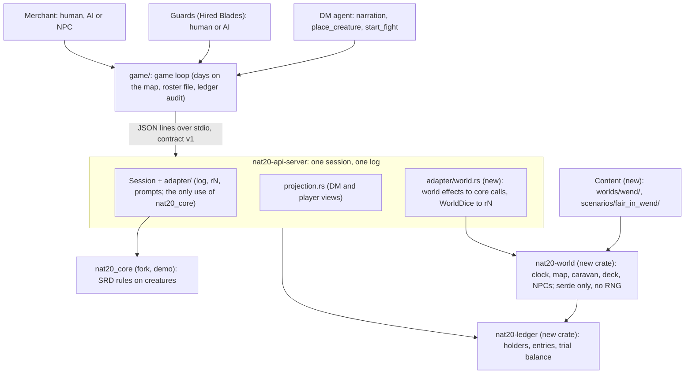

# Milestone 9 "Living world": system design

2026-11-02 · commentable copy: Claude Doc https://claude.ai/artifact/526ws4LhGXdCB9ZVz7ZiYo. Scope: `docs/scope/living-world-scope.md`. Decisions: 0057 (the crates), 0058 (the human plays a Hired Blade).

Status: accepted by Stas on 2026-11-02 (S1 to S4 decided, all as recommended). Source of requirements: the Milestone 9 spec with decisions D0 to D4, accepted 2026-11-01. Checked against core `demo` 0f1bf9b and table `main` 5c77d20 (contract 1.0.0-dev.38).

## Summary

Milestone 9 makes money, things, time, the road and experience engine state instead of the DM's words. This document says how that lands on the existing code: what core and the API contract already have, what we add, where the boundary runs and in which order the PRs go.

- **Goal.** Two roles: the Merchant, who leads the caravan, and the Guards, also called Hired Blades, the hired escort. In the first session the human plays a Hired Blade (S4); the merchant is an NPC or an AI player, and the other seats are AI players. Three loops (adventure, trade, growth) are held together by time and survival. The test bed is the sandbox *Fair in Wend*; the exit is two runs on one build.
- **Untouchable.** Rules 1, 3 and 4, plus one new invariant: coin and items appear and disappear only through recorded events, and the ledger balances to the copper.
- **Boundary (D1).** Rules that act on a creature (saving throws, conditions, rests, XP, level-up, inventory) live in core on `demo`. SRD tables about the world (travel pace, prices, vehicles, rations) live as attributed data in `nat20-world`, with no rules on creatures. Bookkeeping lives in the new crate `nat20-ledger`; the non-SRD world simulation lives in the new crate `nat20-world`; both are in nat20-table. Every roll from either uses the one session RNG and gets an `rN` id.
- **Out of Milestone 9.** Crafting, reputation, our own shop, the road generator (the first step of the Arachas milestone), new pregens, MAP-5, and markets with haggling (API-46, moved to the second sandbox by S4).

## What the code already has

Half the foundation is in core, but none of it reaches the API contract.

| What | core | API contract (table) | Gap for Milestone 9 |
|---|---|---|---|
| Coin | `MonetaryValue` (CP to PP), purse in `Inventory`, `add_money` / `remove_money` | none: `Sheet` has no field; a pregen's coin is read at start and dropped | `remove_money` pays per currency with no change (1 GP does not pay 5 SP) and not atomically: on a shortfall some currencies are already spent. `total_in_gold` is an `f32` |
| Items | `Inventory` = list of `ItemId`; `Item` has `weight` and `value` | `equipment` in `Sheet`, `item_used` in the log | no transfer between creatures, no trade goods in the registry |
| Rest | `start_rest` / `finish_rest`; Long already heals to max and restores all Hit Point Dice | only `short_rest`; `RestKind::Long` already exists in the event | no command; no "16 hours between Long Rests" rule (SRD 5.2.1) |
| Exhaustion | no model | `Sheet.exhaustion` is always 0 (`adapter/sheet.rs`) | needed for hunger |
| Load | weight on items, no carrying capacity | none | a caravan of one or more wagons |
| Experience | `ChallengeRating::experience()` from the SRD table, level thresholds, `experience` in `CharacterLevels` | none | nothing awards XP: no setter |
| Level-up | `LevelUpSession` with prompts; it already builds the pregens (`adapter/pregen.rs`) | none | level 3 features: see Core |
| Creatures outside a scene | any stat block in the registry | `spawn` and `start_combat` only by id from the scene file | API-33/34; four stat blocks in the registry |
| Rolls | thread-local `StdRng`, session seed | id `r<seq>` by log position, `RollView.roller` required (a creature handle) | a "world" roll (deck card, price drift) has no roller |
| Scene | one scene at a time, `load_scene{party}` carries the party | the `adventure.json` skeleton is read by the game loop, `pack:check` and the DM agent | no map, clock or world state between scenes |

Takeaway: coin, XP and the Long Rest are mostly contract work plus small core fixes. The expensive parts are world state between scenes and the level 3 features.

## Architecture

Dependencies point down only, as today. New: the crates `nat20-world` and `nat20-ledger` beside core, and the world bridge in the server as `adapter/world.rs` (inside `adapter/`, Rule 5). The world returns effects (a check, a fight, a ledger entry); the bridge runs them through core and writes them to the same log. Clients and `Seat` do not change.

## World state and the source of truth

World state lives in the server, beside `Game`, in one `Session`, and changes only through contract commands. Every number has one owner; agents and the TUI only read projections.

| Part | Owner | Holds | Changed by |
|---|---|---|---|
| A character's purse and gear | core (`Inventory`) | coin, `ItemId` | `give`, `steal`, `loot`, wages, a night at the inn |
| Caravan (wagons) and cargo | `nat20-world` | cargo lots (good, quantity, weight), the caravan owner | deck events, a night in camp (rations) |
| Clock | `nat20-world` | day, minute of day; the watch is derived | `travel`, `rest_night`, `wait` |
| Map | `nat20-world` | graph from the file, where the caravan is, what is discovered | `travel`, deck cards |
| Deck | `nat20-world` | contents by zone, discard, chains | the engine draws on a leg and at night; discovered places and met NPCs add their cards |
| XP and level | core (`CharacterLevels`) | XP, levels, choices | the engine on `combat_over`, `level_up` |
| Roster | a file the engine writes | the party as pregens plus XP, choices, purses, gear, exhaustion, caravan, rumours, day, place NPCs | `save_roster` at the end, `new_session{roster}` at the start |
| Place NPCs | `nat20-world` | record: name, stat block, place, HP and conditions, alive or dead, attitude to the party, DM notes | entering a place spawns them into core, leaving writes them back; purse = ledger holder `npc:<id>` |

Design decisions that came from checking the code:

1. **Trade goods are not core items.** Nobody wears a sack of flour or hits with it, so cargo lives in the caravan in `nat20-world`, with weight and price from the SRD 5.1 Trade Goods table (5.2.1 has none; a 2014 fill under Rule 7). A character's gear stays in core and sells at half price. Core has no non-creature containers, and the `content/registries/` overlay is not loaded yet. The caravan is a list of wagons (SRD Cart or Wagon, each with its own cargo, limit and team); a new wagon is bought at a market. Cargo sits in a particular wagon, so a "broken axle" card hits only that wagon, and the caravan moves at the speed of its slowest wagon.
2. **One time.** The calendar in `nat20-world` is the only source of day and hour. The calendar does not count combat: inside a fight core keeps time by turn boundaries. When the clock moves (travel, night) the server calls core `advance_time` for every party member, so effects such as Bless expire honestly.
3. **The ledger is log events; the posting rules live in `nat20-ledger`.** Every movement of coin or items is an event `ledger {from, to, what, reason, roll?}`. Holders: a creature, `wagon:<n>`, `market:<place>`, `npc:<id>`, and one external account `world` for rewards and monster loot. The audit sums the entries and checks them against the purses on the sheets at the end of a run. Money in the contract is integer copper, never `f32`. This is double entry in substance (from = debit, to = credit, holders = accounts, the check = a trial balance) without a chart of accounts or a profit report: `reason` is a closed set (trade, wage, loot, toll, inn, theft, reward). A full general ledger comes with our own shop (M17).
4. **A roster is a pregen with a history.** The character is rebuilt by the same `LevelUpSession` that builds pregens, plus level 3 choices, XP, purse and gear. HP is not stored. The exhaustion level and a hunger flag are stored: on load the engine applies one Long Rest by the rule (removes one level, does not remove hunger exhaustion), not a full reset. The engine writes the file, and `run.json` records the roster's sha256 in and out: the hash chain between runs catches a hand edit.
5. **The world roll.** A deck card and a price drift are ordinary `roll` events with an `rN` id, the reserved roller `world` (like `dm`) and a new `RollKind::table`. Additive; `roller` stays required.

## Contract

Every change is additive within v1: the commands and events in the tables below, a `world` block in both `State` views, `purse` and `xp` in `Sheet`. Each row goes into the visibility table in `contract/protocol.md` first, then into the crate (Rules 1 and 3).

### Commands

| Command | Called by | What the engine does | Phase |
|---|---|---|---|
| `give {from, to, what}` | player (own things) | checks 5 feet and possession, moves coin or an item, `ledger` | 1 |
| `steal {actor, target, what}` | player | Sleight of Hand against the target's passive Perception (ENG-32); on success `ledger`, on failure the target notices | 1 |
| `loot {actor, from}` | player | takes the `carries` of a fallen or surrendered creature within 5 feet; `carries` (coin and items) comes from the scene file or `place_creature`, empty by default; the DM never names the amount | 1 |
| `place_creature {stat_block, at, side, name, carries?}` | DM | stat block only from the pack's `stat_blocks` list in `adventure.json` (phase 1); an anchor or a scene point (API-33) | 1 |
| `start_fight {participants}` | DM | initiative as in an authored fight, default end reasons (API-34) | 1 |
| `travel {to?, pace}` | caravan owner, or any Hired Blade when the owner is an NPC | checks the edge, hours from SRD pace and load, draws a card, loads the place or road scene | 2 |
| `rest_night {where: inn \| camp, watch?}` | caravan owner, or a Hired Blade when the owner is an NPC | fee or rations, a night card in camp, Long Rest through core, the Malnutrition save through core when food ran short | 2 |
| `choose_card {card, choice}` | caravan owner, or a Hired Blade when the owner is an NPC | runs the choice: check, ledger entry, fight, card into the deck | 2 |
| `level_up {actor}` | player | at an XP threshold out of combat, opens the `LevelUpSession` prompts as a new `Awaiting::level_up` | 2 |
| `answer_level_up {prompt_id, choice}` | player | answers one `LevelUpSession` prompt with a structured choice; fixture for a full 2 to 3 | 2 |
| `save_roster` | game loop | returns the roster file; `new_session{roster?}` reads it | 2 |

`quote` and `trade` (markets with haggling) are out of Milestone 9 (API-46, S4).

### Events and visibility

| Event or field | DM | Owner | Other players |
|---|---|---|---|
| `ledger` (an entry) | all | all, except a successful theft from them: the victim sees only the new balance in `Sheet.purse` | all, except a successful theft: only thief and DM see that event |
| `Sheet.purse`, `Sheet.xp` | yes | yes | no (another character's sheet is closed anyway) |
| `clock` (day, watch) | yes | yes | yes |
| `world.map`: places and roads | all, with `discovered` | discovered only | discovered only |
| `world.caravan` (cargo, weight, limit) | yes | yes | yes: every Hired Blade sees the caravan |
| `card_drawn` | card id, zone, deck contents | text and choices | text and choices |
| `xp_awarded` | yes | yes | no |
| `place_discovered`, `traveled`, `night` | yes | yes | yes |
| `world.npcs` | all, with HP and notes | met NPCs only: name, place, what is visible | met NPCs only: name, place, what is visible |
| a creature's `carries` | yes | n/a | no until looted; after looting, a `ledger` entry |

Two places where the contract touches the protocol, not only the types. First, §4.4 "fight participants come from the scene file" gets an exception for `start_fight`. Second, the protocol gains the caravan owner: the one viewer whose `travel`, `rest_night` and `choose_card` the engine accepts. `campaign.json.caravan_owner` names it: a player handle or `npc:<id>`. When the owner is an NPC (the first session, S4), the engine follows `route` from `campaign.json`: any Hired Blade calls `travel` without `to` ("we move on"), and a Hired Blade also calls `rest_night` and `choose_card`. The DM never calls these commands; it only narrates.

## Core (fork, `demo`)

Only SRD 5.2.1 rules on creatures go into core; each row is its own `core/<topic>` PR with a test, regenerated `.schemas` and a `PROGRESS.md` row. The most expensive part is level 3: of the four pregen subclasses only Champion is done.

| PR | What | Found in the code | Size |
|---|---|---|---|
| `core/money-change` (ENG-28) | spend with change and atomically; move an item between creatures. Upstream's `MonetaryValue` representation stays; integer copper is computed by the adapter at projection | `remove_money` gives no change and is not atomic | S |
| `core/passive-checks` (ENG-32) | the passive value of any skill by the SRD 5.2.1 Passive Perception formula (10 + bonus, ±5 for Advantage or Disadvantage); using it for Insight is our extension | core has no passive values; the adapter may not compute them (Rule 5) | S |
| `core/experience` (ENG-31) | award XP and split it evenly per SRD; "can level up" | tables exist, no setter | S |
| `core/exhaustion` (ENG-29) | levels 1 to 6 per SRD 5.2.1 (−2 per level to d20 tests, −5 ft speed per level, death at 6), one level off per Long Rest; the Malnutrition save (ate less than half: Con DC 10 at day's end; 5 days without food: a level automatically; not removed until fed). The world only reports eaten or not | no model, the sheet reports 0 | M |
| `core/long-rest` (ENG-30) | exists; add the 16 hour wait after a Long Rest ends (SRD 5.2.1), the 1 HP requirement, ending temporary effects (the TODO in `on_rest_end`) | `systems/time.rs` | S |
| `core/townsfolk` (MON-11) | Commoner, Guard, Bandit, Bandit Captain, Scout, Tough, Noble, and for the road Wolf (exists), Dire Wolf, Worg, Black Bear | 4 monsters in the registry; all named ones are in SRD 5.2.1 | M |
| `core/level-3` (CHR-12) | Life Domain (Disciple of Life, Preserve Life, domain spells), Evoker at 3, Berserker Frenzy (Primal Knowledge exists); level 2 spells for Maren and Ilsa | the Cleric has `subclasses: []`, Berserker and Evoker are empty; the only level 2 spells are Hold Person, Misty Step, Scorching Ray | L, 2-3 PRs |

What does not go into core: the caravan, goods, markets, the clock, the deck. `nat20-world` knows how much was eaten (rations sit in the caravan, not in a creature); core rolls the Malnutrition save and applies exhaustion with an `rN` (Rule 4). Anything harsher than the SRD is only a campaign variant (D2).

## Crates `nat20-ledger` and `nat20-world`

Two crates, both in the nat20-table workspace beside `nat20-api-contract`; no new repo. `crates/nat20-ledger/` is bookkeeping: who holds what and who gave what to whom. `crates/nat20-world/` is the world: clock, map, road, caravan, deck, place NPCs. Both depend on serde only: neither `nat20_core` nor the contract (the server builds contract types). The one link between them points one way: the world returns ledger entries as data, the ledger checks and stores them, and the ledger knows nothing of the world. A CI job `world-pure`, modelled on `contract-pure`, checks both dependency trees and forbids the reverse dependency.

- **Dice from outside.** Every function with randomness takes `&mut impl WorldDice` (`roll(sides, why) -> u32`). The server implements it with core's RNG and logs every roll with an `rN`; tests pass a list of numbers. The crate cannot hold unlogged randomness: it has no RNG of its own.
- **`nat20-world` modules.** `clock` (day, minute, watches), `map` (graph, discovery, travel hours by pace and load), `caravan` (wagons, their cargo and limit, rations), `deck` (zones, cards added by places and NPCs, chains), `npcs` (place NPC records), `roster` (format and hash chain). `market` and `orders` wait for the second sandbox.
- **`nat20-ledger`.** Holders (creature, `wagon:<n>`, `market:<place>`, `npc:<id>`, `world`), money in integer copper, goods as quantities per holder, the entry `{from, to, what, reason, roll?}` with a closed reason set, the journal and balances derived from it for the audit and trial balance only. The ledger never answers "is there enough": the owner of the number does (core for creatures, `nat20-world` for wagons). It is needed already in phase 1 (ITM-6: purse, give, steal, loot), before any world exists, and the audit CLI reads the journal without the world simulation. Full double entry with a chart of accounts waits for M17 (our own shop) and goes into this crate without touching the world.
- **Effects, not core calls.** A deck card or a night returns a list of actions (`Check{skill, dc}`, `Fight{stat_blocks}`, `Ledger{..}`, `Exhaustion{who}`, `LongRest`, `AddCard`). The bridge `adapter/world.rs` runs them through core and returns the check outcome to the world. Rules on creatures stay in core, and the crate is tested without the engine.
- **Money maths** in integer copper; multipliers in per mille, rounding always in the payer's disfavour.
- **Decision record.** Decision 0057 fixes D1 and D2 with the D1 boundary as stated above (core = rules on creatures, `nat20-world` = SRD tables about the world as data): a second rules source beside core, only for what the SRD lacks, always labelled "variant" and switched on per campaign, rolls only through the session RNG. The same record fixes the split into `nat20-ledger` and `nat20-world` (the ledger never depends on the world). Rule 5 gains one line: neither crate repeats any rule core has.

## Game side (`game/`)

The game loop gets a second mode: not "Scenes 1 to 6 in order" but "days on the map until the day limit or 120 minutes". No new transport and no new `Seat`.

- **DM (AGT-24).** Tools `place_creature`, `start_fight` and reading the `world` block in the DM view. The DM gets neither `travel` nor `choose_card`: players call them. Prompt: colour the card and the road; never name prices or coin except from events.
- **Players.** Tools `give`, `steal`, `loot`, `level_up`, `answer_level_up`; the caravan owner (or a Hired Blade when the owner is an NPC) also gets `travel`, `rest_night`, `choose_card`. The viewer stays bound to the agent's own handle. A primer on travel and escort in our own words, with no knowledge of the sandbox. Agents do no arithmetic: they get the finished price, total and balance.
- **The human in any role (AGT-49 and the TUI).** Haiku suggestions only from what the engine says is available (`legal_actions` plus the `world` block). `/map` (a text sketch of discovered places) in the side panel; `/ledger` moves to the second sandbox with markets. Vera: numbers only where she asked for them; pay at the table sounds like a scene.
- **Audit.** Beside "every roll cited": the ledger trial balance to the copper against core purses, a leak scan for hidden fields and deck contents in player views, the roster hash chain. The narration judge (AGT-9) gets purses, cargo, the hour and the latest pay in its digest.
- **Roster.** `rosters/<name>.json` outside the repo (like `runs/`). At start, "new party / continue"; `run.json` records the name and both hashes. Vera must not lose progress: the roster is also written when a run stops on the time limit, not only at the end of the sandbox.
- **DM latency.** The AGT-77 run (22-59-29, `play:unattended`) had DM narration p95 of 9.3 s against a 6 s target. Under decision 0056 that pulls AGT-25 (pipelined narration) and AGT-68 (effort and timeout retune) into Milestone 9. They go in phase 0, before new tool calls: the road adds calls, and the baseline must be clean.

## Content

The world and the sandbox are separate folders: the Wend map is written once and carries *Fair in Wend* now and Arachas later. All JSON with `_comment`, CC-BY-4.0, our own text.

| Path | What | Read by |
|---|---|---|
| `worlds/wend/map.json` | places (`kind`, `market`, `pack_slot`, `discovered`, `scene`), roads (miles, terrain, deck zone), edges with `generate: "road"` (closed in Milestone 9) | server |
| `worlds/wend/goods.json` | goods from the SRD 5.1 Trade Goods table (price, weight; 5.2.1 has no such table, a 2014 fill under Rule 7), attributed to SRD 5.1 | server |
| `worlds/wend/deck/*.json` | zone and place cards, choices with effects and chains; NPCs and packs add their own | server; deck linter in CI |
| `scenarios/fair_in_wend/` | the sandbox: `campaign.json` (an extension of the `adventure.json` format, not a second file: world, start, day limit, allowed stat blocks, enabled variant rules, caravan owner and route, escort contract), place scenes and one shared `road` scene for road events and fights, DM prose, a skeleton for `pack:check` | server, DM agent |

The shared `road` scene removes the risk of "positions without a scene map": it has anchors (ahead, behind, by the wagon, roadside), and `place_creature` uses them. The town name Wendmouth is a draft; it appears only in content and changes with one replace.

## Tests and exit

Each phase ends with a run on Stas's Mac and a regression of *The Silent Mill* on `play:cheap`; CI catches the rest.

| Level | What it checks | Where |
|---|---|---|
| Unit tests for `nat20-world` and `nat20-ledger` | travel hours, nights, the deck on fixed rolls; entries, trial balance, check against owners | `cargo test` |
| Contract fixtures | one per command, including refusals; travel + night + pay on one seed | `contract/fixtures/` |
| Visibility scan | card ids, deck contents, undiscovered places, `carries` before loot and other players' thefts never in a player view, `text` fields included | `leaks.rs`, the `visibility` job |
| World linter | every card reachable, references exist, goods and stat blocks exist, the graph is connected | `npm run pack:check` |
| Run audit | rolls, the ledger to the copper, the roster chain, the narration judge | `npm run audit` |

**Milestone 9 exit:** two runs of *Fair in Wend* on one build, one all AI and one with Stas as a Hired Blade. In each: 3 game days in 120 minutes; at least 2 journeys, the escort contract done with the pay in the ledger, 1 road event and 1 fight outside a scene; the party arrives with the previous run's roster; audit and ledger clean; 0 leaks; p95 measured and compared with the phase 0 baseline.

What the exit honestly does not check: level 3 is not reachable in a three-day sandbox (about 1,550 XP per party, roughly three medium fights). So level-up is checked by a fixture and one hand run with a roster close to the threshold, not by the exit runs.

## Decisions (Stas, 2026-11-02)

S1 and the crate split are recorded in decision 0057; S2, S4 and the pay in decision 0058.

| # | Question | Decided | Rejected |
|---|---|---|---|
| S1 | Where the caravan and goods live | in `nat20-world`, numbers from the SRD; core untouched | in core, as the spec said: a new container kind and the registry overlay (+1 L in the fork) |
| S2 | Who leads the caravan | one owner from `campaign.json`: a player (human or AI) or an NPC; only the owner calls `travel`, `rest_night`, `choose_card`, or any Hired Blade when the owner is an NPC | any player, first wins: agents racing for the reins |
| S3 | How much of level 3 in core | all of it: Life Domain, Evoker, Frenzy, domain spells and level 2 spells; that is the price of Arachas | the minimum: HP and slots only, subclasses later (faster, but players pick an empty subclass) |
| S4 | Who the human plays in the first session | a Hired Blade: the party is hired to escort the caravan, the merchant is an NPC or an AI player. Phases 0 to 2 do not change; phase 3 keeps one escort contract; markets with haggling (API-46) and `/ledger` move to the second sandbox; the exit says "contract done, pay in the ledger" instead of "5 deals". Vera gets through more easily as a Hired Blade: no price tables | the human plays the merchant and trading is tested in Milestone 9 |

**Pay (S4, accepted by Stas 2026-11-02).** Each Hired Blade is paid the SRD skilled-hireling wage, 2 GP a day per person; there is no shared pot. The merchant pays from their own purse (`npc:<id>`), and the engine writes one `wage` entry per Blade. The terms (an advance, the rest on arrival) are in `campaign.json`. A fallen Blade is paid for the days served. If the merchant dies, the rest of the pay is in their purse and can be looted; that is the party's moral choice, not arithmetic.

The name Wendmouth stays open and blocks nothing.

## Risks, without sugar

- **"One scene at a time" stays.** `travel` loads the next scene with the party. Place NPCs persist anyway (API-48): they live as records in `nat20-world` and exist in core only while the party is in their place; after the party leaves, HP, items, coin and death are kept. The cost: between visits an NPC does nothing (no healing, no trading) until schedules exist (+M). Keeping every place live in one core game would break the protocol, L+, not done.
- **Latency.** The DM already misses its target before Milestone 9 (9.3 s against 6 s). Every road event is another call.
- **Cost.** A multi-day sandbox is longer than the Mill: on `play:unattended`, estimated above about $11.50. The day limit in `campaign.json` bounds the loop.
- **LLMs and money.** Agents do no arithmetic; the narration judge catches "paid five gold" against the ledger.
- **Scope.** The first PR is `docs/scope/living-world-scope.md` (D0). The demo scope is not touched, so demo acceptance stays checkable.

## PR plan and TASKS.md rows

Four phases; each row is one PR (or a stack for L), the table stack on top of the core pin. The rows are in `TASKS.md` as of 2026-11-02.

| Phase | Row | What | Dest | Size | Pri |
|---|---|---|---|---|---|
| 0 | CON-16 | `living-world-scope.md`, decision record for `nat20-world` and `nat20-ledger` (D1, D2, the crate split), this design in `docs/design/` | Ours | S | P0 |
| 0 | AGT-73 to AGT-76 | bugs from the M10 runs, unchanged | Ours | S each | P2 |
| 0 | AGT-25, AGT-68 | DM latency 9.3 s to 6 s (decision 0056) | Ours | S | P1 |
| 1 | ENG-28 | `core/money-change`: change, atomicity, item transfer | Fork | S | P0 |
| 1 | ENG-32 | `core/passive-checks`: passive Perception and Insight for steal and haggling | Fork | S | P0 |
| 1 | CON-17 | crate `nat20-ledger` and the `world-pure` job | Ours | S | P0 |
| 1 | MON-11 | townsfolk and road creatures (list extended) | Fork | M | P1 |
| 1 | ITM-6 | `purse` in `Sheet`, `give`, `steal`, `loot`, the `ledger` event; "shops out of scope" goes | Ours | M | P0 |
| 1 | API-33, API-34 | `place_creature`, `start_fight`, a `stat_blocks` list in `adventure.json` (format bump in `pack:check`) | Ours | M + M | P0 |
| 1 | AGT-24 | DM tools for improvised play; the world part is AGT-80 | Ours | S | P0 |
| 1 | AGT-78 | ledger audit and leak scan for the new fields | Ours | S | P1 |
| 1 | AGT-49 | suggestions for the human from what the engine offers | Ours | M | P2 |
| 2 | API-41 | crate `nat20-world` (clock, map, caravan), `travel`, the `world` block in `State`, the world roll, the caravan owner | Ours | L | P0 |
| 2 | MAP-6 | `worlds/wend/`: map, goods, deck, world linter in `pack:check` | Ours | M | P0 |
| 2 | ENG-29, ENG-30 | `core/exhaustion` (with Malnutrition), `core/long-rest` | Fork | M, S | P0 |
| 2 | API-42 | `rest_night`: inn or camp, rations, hunger | Ours | M | P0 |
| 2 | API-43 | road deck, `card_drawn`, `choose_card`, deck linter | Ours | M | P1 |
| 2 | ENG-31 | `core/experience` | Fork | S | P1 |
| 2 | CHR-12 | `core/level-3`: level 3 features of the four pregens (S3) | Fork | L | P1 |
| 2 | API-44 | `xp_awarded`, `level_up`, `answer_level_up`, `Awaiting::level_up` | Ours | M | P1 |
| 2 | API-45 | roster: `save_roster`, `new_session{roster}`, hash chain; "continue" in the TUI | Ours | M | P1 |
| 2 | API-48 | place NPCs that persist; schedules later (+M) | Ours | M | P1 |
| 3 | API-47 | escort contract: terms in `campaign.json`, 2 GP a day per Hired Blade as `wage` entries | Ours | M | P0 |
| 3 | AGT-80 | primer for the road and escort, caravan owner tools, DM guidance for the world | Ours | M | P0 |
| 3 | AGT-79 | `/map` in the TUI | Ours | S | P1 |
| 3 | MAP-7 | the sandbox *Fair in Wend*, no haggling | Ours | M | P0 |
| 3 | AGT-81 | the two exit runs and the decision record | Ours | S | P0 |
| out | API-46 | markets with haggling: second sandbox (S4) | Ours | L | P2 |

MAP-5 stays out of Milestone 9. AGT-77 lives in the demo-close thread. The first PR is CON-16, the second ENG-28 in the fork; phases 0 and 1 run in parallel.
