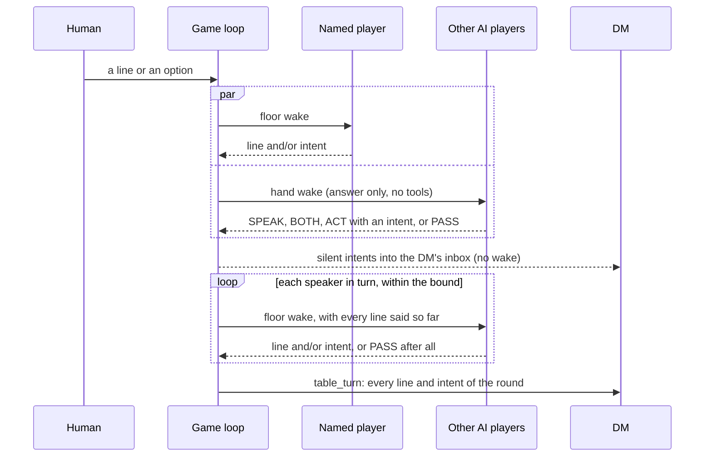

# Party talk: the AI players hear each other, stay silent, and address each other

- **Status:** proposed for review, 2026-10-27. Decided by Stas: the hand-raise floor (§4.3), its place as the first block of Milestone 7 (§8), and background reactions in combat (§5, R1).
- **Decision records:** [0039](../decisions/0039-party-talk-hand-raise-floor.md), [0040](../decisions/0040-every-address-hands-off.md), [0042](../decisions/0042-fight-reactions-first-line-wins.md).
- **Tasks:** AGT-31 to AGT-34 in `TASKS.md`.

## 1. Problem

In the exit run (Scene 1 and Scene 3, Russian, 2026-10-27) every AI player answered each human line as if it hadn't heard the others. Stas asked for three things: players who react to each other's lines and to what is around them, players who can stay silent, and reactions to actions, not only to talk.

The cause is the loop, not the model:

- Out of combat, `declarations()` in `game/src/table/loop.ts` wakes every AI player at once (`Promise.all`). `TableState.collect()` and `commit()` in `game/src/table/state.ts` hold what they say until all of them have answered, then deliver it in seat order. While a player writes its line, no other line exists yet. The others' lines reach its inbox only in the next round.
- The player prompt (`game/src/agents/player.ts`) asks on every declaration for one short line and then an intent or PASS. Silence is allowed, but the prompt invites speech every round.
- In a fight a player is woken only for its own turn, and the brief says to act and call `end_turn`. Nobody reacts to anyone else's action.
- Each declaration is shown to the human a second time as `Torva: …`, which repeats the player's own line, and the DM's narration then tells it a third time.

From the exit-run transcript (four talk rounds, three AI players):

| Measure | Value |
|---|---|
| Lines spoken, of 12 possible | 11 |
| Declarations, of 12 possible | 10 |
| Lines that answer another player's line in the same round | 0 (impossible by construction) |
| Round 4: players who took up the human's question | 0 of 3 |
| Round 4: duplicate intents | Torva sends the captive first while Ilsa wants his hands tied first; all three head for the cellar |
| AI player lines in a seven-round fight | 1 (Maren, when the goblin surrendered) |

The scope already asks for better. Its player behaviour list says an AI player out of combat should "join conversation without talking over the human", and in combat may add "at most one line of in-character speech" (`docs/scope/demo-run-scope.md`, AI players, Behaviour). This design closes that gap; it adds no scope.

Cost today, measured in the Scene 3 run of 2026-10-27 (`usage.jsonl`, Sonnet at low effort): a `declare` wake takes p50 5.7 s, at most 9.5 s, two model calls, about 136k context tokens almost all read from cache, about $0.029 API-equivalent. A talk round is three wakes in parallel, so it waits for the slowest one: 6 to 10 s, about $0.09.

## 2. Goals

Each goal is checked on a run's transcript and report.

1. A player who speaks second has heard the first. Test: with scripted players, the second speaker's brief holds the first speaker's line.
2. Silence is normal: one or two speakers per talk round on average (2.75 in the exit run), and at least 30% of player slots silent.
3. A player addressed by name answers first, in at least 90% of the rounds where the human's or the DM's line names it.
4. In a fight, about one line from an AI player every two rounds and never more than one a round, with no added wait on any turn.
5. A talk round shows its first line within 7 s (p50) and ends within 20 s (p95).
6. Characters address each other according to what they think of each other (§4.4): at least one address between characters per scene; at least 80% of requests and proposals to an AI player get an answer (a word, a deed or an in-character refusal) in the same round out of combat, or on that player's next turn in a fight. No address changes engine state by itself.

## 3. Non-goals and rules that don't move

- No free chat among the players without the human. The human sets the pace; every talk round starts from the human's line or option.
- Players never decide outcomes (Rule 4). A request can become an engine action only through the DM's `help` or `grant_action`, or through the asked player's own turn.
- No engine contract change (Rule 1). Everything here is in `game/` and the scenario pack's cards.
- Visibility (Rule 3): a player reads only what its view allows today. Other players' spoken lines are public table talk and already reach every inbox. The speech guard still checks every line.
- NPC voices stay the DM's job: the DM already reads every line in its `table_turn` wake.

## 4. Talk out of combat

### 4.1 Options considered

| Option | How | Players hear each other | Round wait | Wakes a round | $ a round |
|---|---|---|---|---|---|
| Today | three in parallel, shown at the end | no | 6–10 s | 3 | 0.09 |
| A. Everyone in turn | three one after another | yes | ~17 s p50, ~28 s p95 | 3 | 0.09 |
| B. Two passes | parallel, then parallel again to answer what was said | only in the second pass | 12–20 s | 6 | 0.18 |
| C. Floor by timer | the loop picks one or two speakers (named first, then the longest silent) | yes | 6–12 s | ≤ 2 | 0.03–0.06 |
| **H. Hand-raise (chosen)** | each player decides for itself whether to speak, act, both, or pass; speakers then go in turn | yes | ~3 / 9 / 15 s for 0 / 1 / 2 speakers | 3 short + speakers | 0.06–0.11 |
| R. Director | one Haiku call picks the speakers from the public talk and the cards | yes | ~1.5 / 7 / 13 s | 1 small + speakers | 0.03–0.07 |

Information can only pass from one player to another in sequence, so any design where players hear each other has sequential wakes. The choice is who decides how many.

Stas kept naming the addressee first and rejected the silence timer of C: it makes the quietest character talk when it has nothing to say, and it can't tell "I want to speak" from "I want to act without a word". He chose H, where each character decides from its own role and values. R is cheaper, but a bystander decides for the character and it can't read the player's private notes, which it must never see.

The H and R figures are estimates: a wake that calls no tool is one model answer, and a player's time to first token is about 2.4 s today. The run report measures them (§7).

### 4.2 Order at the table

1. **The named player goes first, always.** When the human's last line names an AI player, or the DM's narration since the last round speaks to one, or an address carried over from the last round names it (§4.4), that player gets a full floor wake at once. A name is the handle, the card's name, or a form listed in `names` on the pack's party entry, Russian cases included («Торва», «Торве», «Ильсу»; «Марен» doesn't decline). In the DM's narration only an address counts: the name set off by a comma in a sentence that speaks to someone, with a question, an exclamation or a second-person word («Ильса, что скажешь?», «Что скажешь, Ильса?»). A name it tells about doesn't count («Ильса читает табличку», «Бертил берёт хлеб у Марен», «У ворот стоят Торва, Марен, Ильса»). Narrations made during a fight («Ильса, твой ход») don't carry into the next talk round, and a fight drops the ones made before it. In the exit run, the DM's narration just before a human line named an AI player 4 times in 13, each time telling about it; it spoke to AI players only in a fight («Ильса, твой ход»). Counted as names, those four would each have cost a floor wake. It may answer in words, deeds or both. It may stay silent, but the prompt asks it to answer, since it was asked.
2. **Everyone else raises a hand or doesn't** (§4.3), in parallel with the named player's wake.
3. **Speakers take the floor one at a time.** Each hears everything said before it, and can still drop its line at its turn ("Torva already said it").
4. **A silent action doesn't queue.** It reaches the DM's inbox and the human's screen as soon as the hands are in (after the named player's wake, when one runs), as one line ("Maren silently bandages Snitt's side"). The DM resolves it in its one `table_turn` wake, with everything else said in the round; it costs no DM wake of its own.
5. **A bound on the round.** At most three floor wakes follow each other in a round: the named player, the speakers, and one hand-off from §4.4 together. A hand still up when the bound is reached lapses, and so does a named player past it; a player spoken to and still waiting when the bound is reached is carried to the next round instead (§4.4).
6. Ties between speakers go by seat order, shifted by one each round. That only breaks ties; it is not a rule about who talks.

### 4.3 The hand-raise wake

- A new player wake, `hand`. The brief holds what was heard and what happened, as today, and asks one question: "Is any of this important to {name} now, given her goal, her character and what she thinks of the others? If not, pass."
- The answer is text only: `SPEAK`, `BOTH`, `ACT: <one sentence>` or `PASS`, with half a sentence of why that the loop logs and never shows (through the speech guard first, since the audit reads every transcript line). An answer that isn't one of the four counts as a pass. A `say`, `submit_decision`, `move`, `end_turn` or `react` call during a hand wake is refused ("wait for the floor"); `look`, `my_sheet` and `note` still work.
- It runs in the agent's existing session for the scene, so its context comes from cache. One model call instead of two.

### 4.4 Addressing a companion

**The term.** An *address* is a spoken line aimed at another character at the table. It takes one of four forms, and all of them travel the same way:

| Form | Example | Expects an answer? |
|---|---|---|
| Remark | Torva to Ilsa: "Writing again? The goblin's about to run." | no |
| Opinion | Maren to Bren: "He yielded. You don't kill him." | no, though it often draws one |
| Request | Ilsa to Torva: "Break that door, quietly." | yes |
| Proposal | Ilsa to everyone: "We tie him up and he walks first." | yes, from whoever it names |

The four forms aren't a field: the model reads them from the words, and the goal 6 numbers come from reading the transcript. The loop doesn't tell them apart either: any address gives its addressee the chance to answer (decision 0040), and the addressee may answer a remark with silence.

**Where a character's view of the others comes from.** Two sources the player agent already has, both its own:

- its card's "With the party" section, its view of each companion at the start (Torva protects Ilsa and thinks Maren's mercy is for after the fighting; Ilsa plans and leaves the choice to Bren; Maren keeps everyone standing);
- its run notes of kind `bond` (`NOTE_KINDS` in `game/src/table/state.ts`), which change during the run ("Torva covered me at the gate", "Bren killed the one who yielded").

The prompt asks the player to choose whom to address, and how, from these, never from sheets. A player never sees another player's sheet; of a companion's health it knows the band (`unhurt`, `bloodied`, `down`) and what the companion said. A character's view can be wrong, and that is fine.

**How an address travels.**

1. An address is a `say` line. The AI player's `say` seat tool gains an optional `to` (a companion's handle, the human's character included). It's a game tool, not the engine contract. With `to`, the addressee is exact, so names are matched in text only in the human's and the DM's lines. A `to` that isn't a companion is refused and costs a retry. The addressee's brief marks the line "ilsa says to you: …", the others' briefs and the DM's say "ilsa says to torva: …", and the transcript's speech record carries `to`.
2. **Out of combat:** an AI addressee gets the floor next in the same round, whatever the address's form (decision 0040): with its hand down it gets a floor wake of its own, and with its hand up it moves to the front. That is the round's one hand-off, inside the bound of §4.2. An address the round can't answer is carried: one made after the hand-off (in the hand-off itself, say), one made outside a floor wake (in a granted action), and one whose addressee is still waiting for the floor when the bound is reached, whether it was carried, queued with its hand up, or the hand-off. Its addressee has the floor first in the next round, after the players the human's and the DM's lines named, and its brief says a companion spoke to it. A fight drops what was carried.
3. **In a fight:** the address is spoken on the speaker's own turn (§5, R0). The addressee reads it on its next turn in the brief, marked as in 1, and acts only on its own turn. An address is not an R1 trigger (§5), and a `to` in a fight never hands off.
4. **The addressee decides** from its card and values: help, answer, argue, refuse in character ("Heal later, hit first"), or stay silent. An address never forces an action.
5. **Mechanics only through the engine (Rule 4).** "Help me with the lock" becomes a declaration the DM resolves with `help` or `grant_action`; Help gives Advantage, as in SRD 5.2.1. "Heal me" in a fight becomes Maren's Healing Word on her turn, if she chooses it. No line sets a result.
6. **An address to the human's character** (Bren in the demo, or whichever character the human plays) shows as an ordinary line, marked "Maren says to you: …"; one to an AI player shows as "Maren says to Ilsa: …". The human answers or not; the loop doesn't wait for it, and never hands the floor for it.

The run report counts the hand-offs and the addresses carried to the next round per run, and the lines spoken to a companion by who spoke to whom.

Cost: no new wakes beyond the hand-off, at most one floor wake (about 5.7 s, $0.03) in a round that has an address. Nothing in a fight.

### 4.5 Role and values in the cards

Each AI player's card gets a section "Talk and silence" (a `##` heading, like every card section; `npm run pack:check` refuses a card without one) with four lines: when the character speaks, when it acts without a word, when it stays silent, and when it addresses its companions. It is our own text, drawn from what the cards already say (Temperament, With the party, Voice). Drafts:

| | Speaks when… | Acts silently when… | Stays silent when… | Addresses companions when… |
|---|---|---|---|---|
| Torva | someone stalls, lies or shows fear; Bren calls the charge; Ilsa needs teasing | there's a door to break, an enemy, a captive to push ahead | the talk is polite, a bargain, a sermon; it has all been said | she hurries everyone and teases Ilsa; asks for little, maybe Maren to lift the fallen |
| Maren | someone is hurt, hungry, afraid or grieving; a yielding enemy is about to be killed; someone is cruel | she can bandage, feed or steady someone without interrupting | the others plan and count; Bren has decided and she has had her say | she argues for mercy, asks to be covered while she heals |
| Ilsa | she hears a name, a date, a contradiction or a lie; there's one more question; pay or a plan comes up | she can write, examine, compare, notice what others walked past | someone comforts or threatens; her question has been asked | she proposes plans, asks Torva for strength and Bren for the decision |

### 4.6 Prompt changes, no added cost

- PASS is a normal answer. Speak when you're addressed, when you know something new, when your character couldn't keep quiet, or to answer someone.
- Don't repeat what another said. One word of agreement, or silence, beats a retelling.
- Answer the last speaker if you have something to say.
- Keep to the card's temperament: Torva short and rare, Maren warm, Ilsa with questions.

## 5. Reactions to actions in a fight

| Option | How | Model calls | Added wait on a turn | Risk |
|---|---|---|---|---|
| **R0. A line on your own turn (decided)** | the turn brief says the player may react in one line to what happened since its last turn; `say` and the brief's "what you heard" and "what happened" already exist | 0 | none (about 30 output tokens) | none |
| **R1. Background reactions (decided, decision 0042)** | on a salient event the player sees in its own view (an ally down or back up, a surrender, a foe down, a critical hit by or against the party, a hit on the player itself), the loop wakes every AI player who may react, at once, with only `say` and "react in one line or pass". The first line is heard and shows the moment it is ready, even before the DM narrates its trigger; the other wakes are cancelled. The fight doesn't wait | one short wake per eligible player per trigger, ≤ 1 trigger a round | none on the turn path | one session per agent: the player whose turn comes next and the one whose deed it was never react; if a reacting player is woken again, that wake waits at most 5 s, then the reaction is cancelled |
| R2. Reactions to the DM's outcome out of combat | after a narration with a big outcome, one reaction before the human's next line | +1 wake when triggered | +~6 s on that round | not tracked: in H the players hear the outcome at the start of the next round anyway |

R1 costs about $0.02–0.03 a wake, so about $0.06–0.09 a trigger with three AI players, and at most about $0.6 for a seven-round fight. Triggers come from events every player view carries, the reaction's brief is the player's own view of them, and the speech guard checks the line, so no HP, AC or DC can reach it (Rule 3).

How R1 runs (spec `party-talk-r1-spec.md` in the project folder, `game/src/table/reactions.ts`, `TableLoop.startReactions`):

- **Triggers**, in the order a batch's are taken: a party member down or dead, a party member back up, a surrender, a foe down or dead, a critical hit by or against the party, damage to an AI player. "Party" is every character at the table, so the human's character counts as an ally like any other. The rest of a batch reaches the players in their next briefs, as before. A surrender, or the last foe down, ends the fight in the same batch, and still gets its reactions, alongside the DM's wrap-up of the fight.
- **Who may react:** a conscious AI player that isn't the next actor and isn't the one whose deed it was, the creature that last acted (its own critical hit or kill is for its own turn, R0). It is keyed on the seat map alone, so it holds when the human plays any character and when every character is an AI player.
- **The wake:** a `bark` wake with `BarkTools`: `say` and `note` work, every other tool answers "not now". The first `say` takes the floor; a later one is refused ("X spoke first"). A line the speech guard refuses, or a `to` that isn't a companion, is dropped with no retry, and the floor is free again.
- **Timing:** a reaction is cancelled after 8 s, or when its player is woken again and 5 s have passed. A cancelled wake interrupts its session the way a turn timeout does, so its late `say` is refused ("the moment has passed").
- **Report:** fight talk (AI lines per combat round, on and between turns, against goal 4's about 0.5) and fight reactions (triggers, wakes, lines shown, passed, beaten by another's line, cancelled or timed out, bark wake p50 and p95).

## 6. The echo line

Speech still reaches everyone directly: `Torva says: …` is shown at once, and every player reads it in its inbox, as today. What changes is the third line of the same character in the same round: `Torva: …`, the intent that retells its own speech, is no longer shown to the human. The DM still gets it, and the transcript keeps it, so the audit and the metrics don't change. A silent action (an intent with no line) is still shown, or the human wouldn't know the character does anything. The change is in `TableState` (`game/src/table/state.ts`), which already decides what reaches the human's screen, and undoes in two lines.

## 7. What changes in code

| Where | What | Size |
|---|---|---|
| `game/src/table/floor.ts` (new) | the order of §4.2: named player, hands, the bound, the hand-off, ties; a pure function with unit tests | S |
| `game/src/table/loop.ts` | `declarations()` becomes the hand-raise round; R0 in the turn brief; R1 triggers and background wakes | M |
| `game/src/table/state.ts` | §6; lines are delivered as they are spoken; `collect`/`commit` leave the talk round | XS |
| `game/src/agents/player.ts` | the prompt of §4.6; the `hand` wake; `to` on `say`; the R1 `bark` wake with `say` only | S |
| `scenarios/the_silent_mill/cards/*.md` | the "Talk and silence" section | XS |
| `game/src/ui/lines.ts` | the "speaks to you" mark | XS |
| `game/src/table/scripted.ts`, `game/test/` | scripted players that pass, raise hands and address each other; the test that the second speaker heard the first | S |
| run report | speakers per talk round, silent share, time to first line, round wall time by phase, addresses and answers, reactions per fight | S |

The engine contract, the server and core don't change.

## 8. Delivery

Milestone 7, first block, before the three timed playthroughs (Stas, 2026-10-27): the change alters the length of a round and the number of model calls, so it moves acceptance §6.1 (120 minutes) and §6.4 (latency), and a timing taken before it would be taken again.

One step per PR, stacked, each with scripted tests in CI (CI never calls a model):

1. AGT-31: the prompt of §4.6, R0, the cards' "Talk and silence" section, and §6. Shows on the next run.
2. AGT-32: the hand-raise round of §4.2 and §4.3, and the report's round measures.
3. AGT-33: addressing a companion, §4.4.
4. AGT-34: R1, decided by Stas (decision 0042).

After steps 1 and 2 Stas plays `npm run play:exit` on his Mac and attaches the run folder; the goals of §2 are read from its report and transcript.

## 9. Risks

- A round with two speakers waits longer than today's (about 12 s against 6–10 s). The first line comes sooner, and the human reads two lines instead of six.
- Sonnet at low effort may talk anyway. The bound of §4.2 holds that in the loop, not in the prompt.
- Matching Russian names in the human's and the DM's text is brittle (cases, nicknames). An implicit address ("who here can heal?") isn't matched, but the hand-raise catches it: Maren decides the question is hers.
- R1 adds concurrency to an agent's session, which was strictly sequential. That's why it is the last step and its own PR. The loop never wakes a player with a reaction in flight for another reaction, makes any other wake of that player wait for it (at most 5 s), and cancels it only while it runs, so a cancel never ends the player's next wake.
- In R1 the fastest player, not the most moved one, can win the floor. A run report with one character speaking nearly every reaction shows it.
- Costly to undo: only the turn-taking model in decision 0039, if the North Star front end is built on it. The code is reversible.
