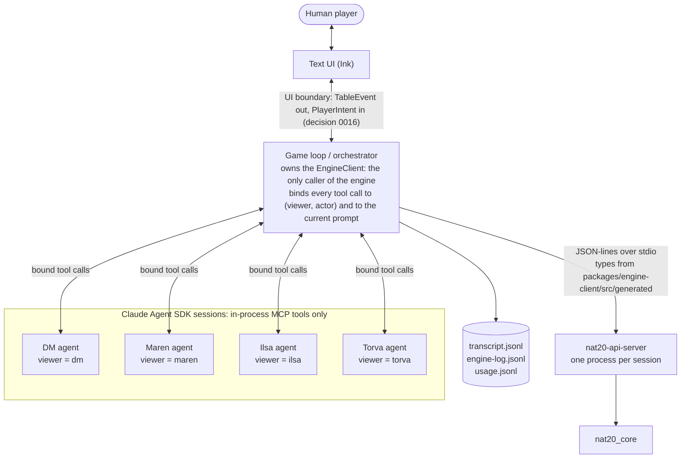

# Milestone 6: agents at the table

- **Status:** Proposed (spec only; nothing here is built yet)
- **Date:** 2026-10-23
- **Owner:** Stas
- **Depends on:** Milestones 3, 4 and 5 done (main 3f74dfe, contract `1.0.0-dev.30`, core pinned at fork `demo` d9c6b37). Open engine gaps that steps below wait on are listed in §9 with the step each must land before.
- **Exit criterion** (`TASKS.md` § Milestones): one full scene of *The Silent Mill* played by the DM agent, the player agents and a human in the text UI, with visibility enforced. The exit run plays Scene 1 and Scene 3 (D1, Stas 2026-10-23).

Milestones 1 to 5 built the engine side: every rule the adventure needs resolves in `nat20_core`, behind contract v1, with seeded fixtures and an audit. Nothing on the game side exists yet: no `game/` directory, no agents, no text UI, and the adventure itself is only test scenes. This milestone builds the table: the game loop that drives the engine, the DM agent, one agent per AI player, the human's text UI, the transcript and its audit, and *The Silent Mill* as real content. It ends with Stas playing Bren through two scenes with an AI DM and an AI party.

## 1. Goal and non-goals

**Goal.** A human plays *The Silent Mill* in a terminal with an AI DM and two or three AI party members, and nothing an agent says or does can change the game except through the engine:
- the **game loop** (orchestrator) owns the one engine process and is the only code that talks to it;
- the **DM agent** narrates from the adventure file and the engine's events, turns the human's free text into engine commands, picks checks from the scenario or the SRD DC ladder, and has no tool that sets an outcome;
- each **AI player** (Maren, Ilsa, Torva) is its own agent with its own context, tools bound to its own viewer handle, a personality card and private notes;
- the **text UI** (Ink) gives the human free text plus `/sheet`, `/where`, `/options`, `/log` and `/pause`, with every roll shown inline from the engine's own text;
- every session writes a **transcript** and the engine log, and the **audit** passes on them: every cited `[rN]` matches the log, every roll is cited, nothing uncited looks like a roll;
- every model call records its **tokens, cost and latency**, from the first scene on (AGT-10, Stas 2026-10-21);
- *The Silent Mill* exists as the first **scenario pack**, a folder the game can load from any path: six engine scene files, the DM's skeleton and Markdown prose, the personality cards and the lore it draws on.

**Non-goals** (each has its own milestone or row):
- The three timed unattended playthroughs, the latency gate, pacing and the narration-vs-state check: Milestone 7 (AGT-9, AGT-12 to AGT-14). This milestone records latency and cost and builds the harness; it does not gate on them.
- A stand-in for the human seat in unattended runs: Milestone 7 (AGT-14). The seat is an interface here (§3.4) so a stand-in can take it later.
- OpenTelemetry (AGT-16, P2, after Milestone 7).
- The North Star: an MCP server, Telegram, a web or mobile client, more than one human, saving a campaign (decided 2026-10-21: after Milestone 7). The UI boundary is shaped so a later client can replace it (decision 0016), nothing more.
- Monster turns by an LLM: monsters stay on the scripted policy (decision 0015). Handing monster turns to the DM agent is a later option, not part of this scope (AGT-23, after Milestone 7, Stas 2026-10-23).
- Graphics, widgets, voice (scope §5; widgets only where they simplify development, which on Ink they don't).
- New rules. If an agent finds a rule the engine gets wrong, it is a fork or table row, not agent logic (Rules 4 and 5).

## 2. What exists today, checked against main 3f74dfe

| Need | Today | Consequence |
|---|---|---|
| A typed client for the engine | `packages/engine-client/src/index.ts`: spawns the server, checks `schema_sha256` on `hello`, sends one command and resolves its response, binds `viewer` in `envelope()` so tool input can't override it | **Keep it.** Step 3 adds the event cursor, a request log, crash detection and start arguments (AGT-2) |
| The engine runs outside its checkout | Scene data, pregens and the terrain mesh come from `env!("CARGO_MANIFEST_DIR")` (`server.rs`, `scene.rs`, `adapter/pregen.rs`) | **API-18 first** (step 2): the game spawns the binary from elsewhere |
| Monster turns | Scene creatures with `control: scripted` act inside the engine; their events come back in the response to the request that ended the PC's turn | The game loop never decides for a monster |
| Who decides for a PC | `control: client`; `legal_actions`, `submit`, `move`, `react`, `end_turn` with prompt ids (protocol §3, §4) | Enough for every agent decision. **No new engine command is planned** (§5) |
| Visibility | `projection.rs` per `viewer`; the `visibility` CI job scans projected lines; player roll view is strict (decision 0006) | Player agents only ever see projected responses. The new risk is free text the DM writes (§3.5) |
| Roll ids and the audit | `[rN]` ids, session-unique; `crates/nat20-duel/src/audit.rs` checks a transcript against the DM log using the server's `render::roll_summary` | Reuse it (D4) |
| Scene files | `crates/nat20-api-server/data/scenes/`: test scenes only (`m5_s3_yard`, `m5_s5_cellar`, the `m3_*` trail). Typed by the contract (`scene.rs`), with a free `description` and no narrative fields | The adventure's six scenes are new content (MAP-4); its story text goes in a game-side file (D3) |
| Pregens | `pregens/{fighter,cleric,wizard,barbarian}_l2.json` | Used as they are |
| Maps | `maps/flat_arena.obj` only | Scenes use flat terrain plus named anchors (D7) |
| `game/`, `scenarios/`, `lore/` | Do not exist (CLAUDE.md lists them in the layout) | Created here |
| Node toolchain | npm workspace `packages/*`, Node ≥ 22.6, TypeScript 7, `node --experimental-strip-types` for tests | `game/` joins the workspace. Ink needs JSX, so `game/` builds with `tsc` (step 11) |

## 3. Architecture



### 3.1 Who talks to the engine

Only the orchestrator holds an `EngineClient`, and the engine has one client per process (protocol §1). Agents never see the client, a request envelope, a `viewer` field or a prompt id:
- Each agent gets tools as **in-process MCP tools** of its Agent SDK session. A tool handler calls the orchestrator, which fills `viewer` from the seat the agent was created for, takes the `prompt_id` from the current `awaiting` (in combat; explore commands carry none, protocol §4.8), checks the call is allowed now, and sends it.
- **Viewer is always bound.** No agent's tool input has a `viewer` field. `envelope()` already sets `viewer` last; the tool layer adds the second lock.
- **A player's actor is always bound** to its own character: its tool inputs have no `actor` field. Its `submit_decision`, `move` and `end_turn` pass in combat only while `awaiting.actor` is its character; out of combat only `submit_decision` exists for it, once per DM grant (§3.3), since moving out of combat is the DM's call and `end_turn` there answers `wrong_mode`.
- **The DM chooses a subject, never a viewer.** The DM's check, sheet and explore tools (`request_check`, `get_sheet`, `move`, `help`) take an `actor` the orchestrator validates against the creatures in the scene, because the DM asks Maren for her Insight check. The DM's decision tools (`legal_actions`, `submit`, `move` and `end_turn` in combat) are bound to the human's character and take no `actor`, so the DM can't act for an AI player or a monster.
- `stale_prompt` is the orchestrator's problem, not the agent's: it refreshes the prompt and resends once, and it doesn't count as an agent retry.
- The UI never calls the engine either. It sends `PlayerIntent`s to the orchestrator and renders `TableEvent`s (§3.4).

### 3.2 The agents

All agents run on the **Claude Agent SDK** (decision 0019), configured so the harness adds nothing we didn't put there:
- **No built-in tools.** No Read, Bash, Grep or web tools: the repository holds the scenario files, so a player agent that can read files can read the DCs. Each session gets only its own MCP tools.
- **No setting sources** and an empty working directory: no CLAUDE.md, no project settings, no skills leak into an agent's context. The only skills an agent can have are our own, loaded from a path the game passes (D10): the DM's guidance goes to the DM session only, never to a player session, and each skill is a single file because no agent can read files.
- **Our own system prompt**, replacing the SDK's default, so the per-call prefix is small and identical call to call (cacheable).
- **One long-lived session per agent per scene** (streaming input). At a scene change the orchestrator asks each agent for a short summary, closes the session and opens a fresh one seeded with the card, the sheet, the agent's notes and the summary (AGT-6). Context stays bounded by one scene, and the cached prefix is stable within it.
- Model and effort per agent are config, not code (D2).

| Agent | Sees | Tools | Never has |
|---|---|---|---|
| **DM** (`viewer: dm`) | The scenario pack's skeleton and prose (D3), the current scene file, the DM projection of state and events, the human's text, the players' spoken lines and declarations, its own memory (§3.6) | `get_state`, `get_sheet` (any creature), `load_scene`, `start_combat`, `end_combat`, `spawn`, `request_check`, `help`, `short_rest`, `move` (explore mode, any creature), `legal_actions`, `submit`, `move` and `end_turn` in combat **for the human's character only**, `grant_action{actor}` (out of combat, lets an AI player take one of its own options, §3.3), `narrate{text, to}`, `ask_human{question}`, `remember{fact}` (§3.6) | A tool that sets HP, a roll, a check result or damage (none exists in the contract); `submit` for an AI player's character; a monster's decisions |
| **AI player** (`viewer: <own handle>`) | Its own sheet, its personality card, its own notes, the player projection of state and events, narration addressed to the table or to it, other characters' spoken lines | `my_sheet`, `look` (state projected for it: anchors, visible creatures, distances), `legal_actions`, `submit_decision`, `move`, `end_turn`, `react`, `say{text}`, `note{kind, text}` (§3.6) | The scenario, DCs, monster HP or stat blocks, the DM's reasoning or memory, other players' sheets or notes (scope §4.3) |

`look` is new against scope §4.3's tool list; it is the read-only `get_state` projection, which is what "what its character perceives" means in engine terms. Only `submit_decision`, `move`, `end_turn` and `react` change state, and the engine validates all four.

### 3.3 The turn loop

The orchestrator is plain, deterministic TypeScript, not an agent. It reads `awaiting` after every engine response and decides who is woken next.

**Explore and social mode** (scope §4.4):
1. The DM narrates the scene, its anchors and its obvious options.
2. The human types an action or a line.
3. Every AI player is asked **in parallel** for at most one declaration (`say` and/or a stated intent) or a pass; the orchestrator orders them after the human's.
4. The DM maps the declarations to engine calls (`request_check` with the declaring character as `actor`, `move`, `help`, `short_rest`, `start_combat`, `load_scene`), or answers in fiction when no engine call fits, or asks the human a clarifying question. When an AI player declares one of its own options (Cure Wounds at camp, Second Wind; protocol §4.8), the DM doesn't submit it: it calls `grant_action{actor}`, and the orchestrator wakes that player with its explore `legal_actions`; the player's `submit_decision` (no prompt id) is accepted by the orchestrator once per grant. The human's own explore actions go through the DM's `submit` for Bren.
5. The engine resolves; the DM narrates the outcome. Repeat until the adventure file's exit for the scene fires, then `load_scene{next, party}`.

**Combat mode**:
1. `start_combat`; the engine rolls initiative and runs any monster turns up to the first PC.
2. `awaiting.kind: action` for the human's character: the UI shows `/options` (from `legal_actions` with `viewer: bren`). The human answers with an option number or free text. `/options` lists **complete decisions**, not bare option ids: one numbered line per option and target for single-target options, one per variant where an option needs one, and for an area or multi-target option a numbered follow-up pick (anchors, creatures or points from the option's own list), so a number always becomes a complete `submit` with no model call. Free text, which the DM agent maps to `submit`/`move`/`end_turn` for Bren (D5). A rejection goes back to the human with the engine's sentence.
3. `awaiting.kind: action` for an AI player's character: the orchestrator wakes that agent with its `legal_actions` and the events since its last turn (projected for it). It acts through its tools until it calls `end_turn` or the prompt moves to someone else. Only the acting player's agent is called.
4. `awaiting.kind: reaction`: the owner answers. An AI player's agent gets the trigger summary and the options and calls `react`. The human gets a yes/no line in the UI.
5. Monster turns happen inside the engine. Their events arrive in the response to the PC turn that preceded them.
6. After each PC turn, and once for each run of consecutive monster turns, the DM narrates the new events in one to three sentences. To keep turns fast, the next actor's agent starts deciding while the DM narrates; the UI shows narration before the next actor's output, so the order on screen is unchanged.
7. `awaiting.kind: combat_over`, or the DM's `end_combat{surrender|fled|scenario}` when the scene allows it: the DM narrates the end and the loop returns to explore mode.

### 3.4 The UI boundary and the human seat

The text UI talks to the game loop through one in-process boundary, as decision 0016 requires:
- **Out:** `TableEvent`: narration start/content/end (speaker, addressee), an engine line (the event's own `text` rendered for the human's viewer, with its roll id), a state snapshot for `/sheet` and `/where`, a prompt for the human (options or a reaction yes/no), a status line (whose turn, round).
- **In:** `PlayerIntent`: free text, an option number, a reaction answer, a slash command.

These are game types in `game/`, not engine wire: they never cross the engine boundary, so Rule 1 doesn't apply, but they are shaped one-to-one onto AG-UI's text, state and tool-call events so a later web client can replace Ink without touching the loop.

The **human seat** is an interface (`Seat`) the loop calls when the human's character must act or react. The Ink UI implements it in this milestone. Milestone 7's unattended runs plug in a stand-in that implements the same interface (AGT-14).

Commands (scope §4.5, AGT-7): `/sheet` (`get_sheet` for Bren), `/where` (anchors and visible creatures with distances, from the player projection), `/options` (numbered `legal_actions`; outside a fight, what the DM offered), `/log` (the last engine lines with their roll ids), `/pause` (AI players stop being woken until `/pause` again). Rolls appear inline as the player roll view renders them: dice, total and outcome. Scope §4.5's example "17 vs AC 18, miss" predates decision 0006; the human sees "17, miss", and the AC stays on the DM's side.

### 3.5 Keeping free text honest

Projection makes every engine response safe for its viewer. Two kinds of text are not engine output and need their own guard:
- **DM text addressed to players** could name a DC, a monster's HP or a scenario secret (Rule 3, "free text included"). The orchestrator's **narration guard** runs live on **every DM-authored string a player or the human receives**, `narrate` and `ask_human` alike, before it is shown. It refuses text that holds a digit or a spelled-out number outside a roll citation, a game-stat term (armour class, AC, DC, difficulty class, hit points, HP, saving throw bonus, attack bonus, challenge rating), or a DM-only token it can name mechanically: a scene check, stat-block, hazard, flag, encounter or spawn id, a surrender condition. The DM gets the reason and retries (§6).
- What a filter can't catch is a secret told in plain prose ("the third goblin is nearly dead" when the band says bloodied). The DM's prompt states the rule, the guard catches the mechanical forms, and the leak scan reads the whole run afterwards; a prose leak found on the exit run becomes a finding and a stronger check (a cheap second-model review of player-facing DM text) before Milestone 7. This residual risk is accepted for Milestone 6, not hidden.
- **Narration that states a result** the engine didn't produce: the same guard refuses narration that cites a roll id the log doesn't have. Whether the prose contradicts state (a goblin "falls" that is still up) is AGT-9, Milestone 7.

Every model input a player agent receives is also written to the run directory, and a **leak scan** (step 6) runs over it after every test run: no DC, AC, HP number of a creature the player doesn't own, `against`, `dc_source`, scenario id or DM-only event kind may appear. This is the agent-side twin of the `visibility` job.

### 3.6 Agent memory (D9)

Memory lasts one run. Memory that carries over between runs and campaigns is campaign saving, which comes after Milestone 7 (North Star question 6, Stas 2026-10-21; TASKS.md AGT-22).

- **AI players** keep private notes with `note{kind, text}`, where `kind` is `fact`, `promise`, `suspicion`, `plan` or `bond`. The personality card shapes what a character chooses to remember. Notes are always in the agent's context, appended in order, capped in size; at a scene change the summary folds the oldest ones (AGT-6). No other agent, the DM included, reads them: a DM that reads the players' plans metagames in reverse.
- **The DM** keeps a memory of what it established in fiction that the engine doesn't track, with `remember{fact}`: an NPC's improvised name, what the captured goblin promised, a door it called locked. It is seeded into every new DM session with the pack and stays in context. This is what keeps narration from contradicting earlier narration.
- **Fiction only.** Hit Points, positions, conditions, DCs and roll results are always read fresh from the engine, never from memory. A `remember` call goes through the narration guard (§3.5), so it can't hold a number outside a roll citation or a DM-only id.
- **Memory never decides an outcome.** "The goblin owes the party a favour" can change which check the DM asks for or the DC rung it picks from the ladder; the engine still rolls and resolves (Rule 4).
- **Visibility.** DM memory is DM-only by construction: a player agent's input is built only from its own projection, guarded narration, spoken lines and its own notes, so a remembered fact reaches a player only if the DM narrates it. The leak scan (§3.5) can't tell a secret written in plain prose, so step 10 adds its own test: a scripted DM remembers a sentinel fact it never narrates, and the sentinel must appear in no player agent's recorded input. A player's notes reach only that player.
- **Audit and cost.** Every `note` and `remember` is written to the transcript on its owner's channel, so Milestone 7's narration check (AGT-9) can compare narration with what the DM established. Memory is only appended, never rewritten, so the cached prefix stays valid.

## 4. The scenario: format and where it lives

*The Silent Mill* is our own content (CC-BY-4.0, decision 0018). Adventure content never goes into core (Rule 6) and stays out of the contract crate unless the engine reads it (Rule 1).

An adventure is a **scenario pack**: a self-contained folder the game loads from any path it is given, so a new adventure can live in this repo, in its own repo, or in a private folder (D3, Stas 2026-10-23). *The Silent Mill* is the first pack and lives in this repo.

```
scenarios/the_silent_mill/        a scenario pack; any folder with this shape works
  adventure.json     the skeleton: format_version, scenes in order, exits, NPC list,
                     which check fits which intent, target times, links to prose files
  prose/             Markdown the skeleton points to: read-aloud openings, what the
                     characters can notice, NPC notes and voice, adventure lore
  scenes/            engine scene files, one per scene (SceneFile, contract-typed)
  cards/             personality cards for the AI party members, Markdown (CHR-5)
  README.md          credits, licence, scene list for humans
lore/                shared setting text several packs can draw on (CLAUDE.md layout), our own
```

- **Engine scene files** move into the pack for the real adventure (the test scenes stay where they are for fixtures). The game passes the pack folder to the engine as its data directory (API-18), and the engine reads `scenes/<scene_id>.json` from it as it does today (protocol §2.1). Each holds anchors, creatures, `party_start`, checks with DCs, hazards, encounters with surprise and surrender conditions, and spawns, exactly as the contract types them. The two fights reuse what `m5_s3_yard` and `m5_s5_cellar` prove (Milestone 5), with the adventure's anchor names. The Silent Mill uses the repo's `pregens/`; the same argument lets a later pack bring its own.
- **The skeleton, `adventure.json`,** holds only what can break the game and so must be checked: `format_version`; per scene its scene file id, exits (which one loads which scene, and the party carried), the NPCs (id, name, which prose file describes them), which engine check fits which kind of player intent (by check id), and a target time (scope §3 table); and the path of every prose file it uses. JSON with `_comment` keys for human notes, like pregens (decision 0025), typed with a published JSON Schema in `game/` (decision 0031).
- **The prose** is plain Markdown, so porting an adventure is mostly pasting text and wiring a few ids. Nothing in it is parsed for game logic; the DM agent reads it as written.
- **Checked in CI** (step 8), for every pack in the repo and by a command anyone can run on a pack outside it: the skeleton validates against its schema and its `format_version` is one the game reads; every scene, anchor, check, encounter and spawn id it names resolves in the pack's scene files; every prose and card file it names exists; every scene loads in order with the party carried.
- **Two-way door.** The JSON shape and `format_version`, not where the type is defined, are what packs depend on. Moving the type from `game/` into the contract crate later (if the engine ever reads part of it) keeps every pack valid; a format change bumps `format_version` and the game reads both until old packs are migrated.
- **Licence.** A pack committed to this repo, shown or shared carries only our own text or CC-BY text (Rule 7). A private pack of a published adventure stays outside the repo and is never committed (scope §2).
- **Personality cards** (CHR-5): goal, temperament, one quirk, how the character treats the party (scope §4.3). A card is the only character text in a player agent's prompt besides its sheet.
- **Visibility.** The skeleton, the prose and the scene files are DM-only. Only the DM agent's prompt ever includes them. Player agents learn the scene from narration.

## 5. Contract changes (Rule 1)

No new engine command, field or event is planned for this milestone. Every agent decision is already a contract v1 command (protocol §4), and every view the agents need is already projected. The game-side types (`TableEvent`, `PlayerIntent`, the adventure file, transcript records) are not engine wire.

Engine-side changes this milestone depends on, each its own PR under Rule 1 if it touches the wire:

| # | Change | Row | Wire impact | Must land before |
|---|---|---|---|---|
| C1 | Runtime paths: the scene data, pregens and maps directories come from a server argument or environment variable, not the build checkout | API-18 | None (start-up only); `protocol.md` §2.1 says where scenes are read from | Step 3 |
| C2 | A `submit` whose action can't be taken after the walk is refused or reported, never accepted silently | API-31 | Likely additive: a reject reason or an event, decided in API-31's PR with a fixture and CHANGELOG line | Step 9 (AI players in a fight) |
| C3 | A scripted monster's move into melee logs `moved` | API-32 | None (the event exists) | Step 10 (the DM narrates monster moves) |
| C4 | `submit` stops rebuilding the full option list | API-17 | None | Step 12 (latency is measured on the exit run) |

If a step finds that it needs more (for example a way to read events for one actor), that becomes its own contract-first PR stacked before the step, with its fixture, CHANGELOG line and generated files.

## 6. Failure and retry model (AGT-11)

Acceptance item 5: every rejected decision recovers within two retries. The orchestrator counts per decision and writes every retry and fallback to the transcript.

| Failure | Who sees it | What happens | Counts as a retry |
|---|---|---|---|
| Engine `rejected` or `unknown_*` (retryable) on an agent's tool call | That agent, as the tool result: the engine's `message` and, for the DM, `hint.known_ids` | The agent tries again | Yes |
| `stale_prompt`, `not_your_turn` | The orchestrator | Refresh `awaiting`, resend once or drop the call | No |
| Non-retryable (`bad_request`, `wrong_mode`, `internal`) | The orchestrator | Logged as a loop bug; the decision falls back | Yes, as a failure |
| Narration guard refusal (§3.5) | The DM | The DM rewrites | Yes |
| The agent ends its turn without acting, or answers in prose with no tool call | That agent | One nudge naming the tools; then fall back | Yes |
| Model error or timeout (rate limit, 5xx, network) | The orchestrator | The SDK retries; past the turn timeout (player 20 s, DM 12 s) the decision falls back | No (latency, not a rejection) |
| Two retries spent | The orchestrator | **Fallback**: an AI player's combat turn ends with `end_turn`; a reaction is declined (`choice: null`); an explore declaration is a pass; DM narration is replaced by the engine lines alone; a DM intent mapping for the human goes back to the human as "I didn't get that; pick from /options" | Recorded as a fallback |
| The human's decision is rejected | The human | The engine's sentence plus `/options`; no limit, but the count is recorded for acceptance 5 | Recorded |
| The engine process dies | Everyone | The run stops with its transcript and log written; no resume (saving is out of scope) | n/a |

A fallback never invents an action: `end_turn` and a declined reaction are always legal, and nothing else is chosen for an agent.

## 7. Cost and latency budget (AGT-10)

Every model call records, in `usage.jsonl` next to the transcript: agent, model, effort, input tokens, cache-read and cache-write tokens, output tokens, list-price cost, wall time, and the turn it belongs to. The run summary sums them per agent, per turn and per scene, and reports p50 and p95 latency for player turns and DM narration.

| | DM | Each AI player |
|---|---|---|
| Model now, for Stas's own testing (D2) | Opus 5.5, low effort | Sonnet 5.5, low effort |
| List price per million tokens (2026-10-23) | $4 in, $20 out, $0.20 cached read | $2 in, $10 out, $0.20 cached read |
| Model later, for a beta (D2) | Sonnet 5.5 ($2 / $10) | Haiku 5.5 ($0.10 / $0.50) |
| Latency target (scope §6.4) | narration p95 ≤ 6 s | turn p95 ≤ 10 s |
| What drives cost | the adventure and scene files in its prefix, every narration and intent mapping | a short prefix, one call chain per own turn |

Rough expectation, to be replaced by step 1's measurement: on the testing models a full run costs in the low tens of dollars, and on the beta models a few dollars, most of it the DM in both cases; caching the DM's prefix is the largest lever. **Budget:** none is enforced while Stas tests on the expensive models. Every run records its cost, and the beta models carry a target of under $5 per full Scene 1 to 6 run. Opus may miss the DM's 6 s p95; step 1 measures it, and if it does, the timed runs of Milestone 7 use the beta DM model.

Latency levers, in order: the small own system prompt (no SDK default prompt), low effort, prompt caching, narration pipelined with the next actor's decision (§3.3), option numbers that skip the DM for the human's combat turns (D5), and API-17 on the engine side.

## 8. Ordered task breakdown

Each step is one PR (Rule 8, one concern), stacked on the one before, green on every CI job, with its TASKS.md rows. **CI never calls a model:** every loop step ships with **scripted agents** (deterministic stand-ins that implement the same agent interface from a fixed policy) and a seeded game fixture, so the loop, the bindings, the transcript and the audit are tested without an API key. Live-model runs are manual, and their reports go to the PR description.

| # | PR | Rows | Needs | Size |
|---|---|---|---|---|
| 1 | **Spike.** `game/` workspace scaffold; one player-agent turn and one DM narration on the Agent SDK against a recorded engine state, cold and warm, with the configuration of §3.2; records latency, tokens and cost per call; licence check of the new npm dependencies; checks whether the SDK loads skills from our own path while setting sources stay empty (D10). If p95 can't meet §7 on this stack, stop and bring decision 0019 back to Stas before step 9 | AGT-17 (new), AGT-10 | | S |
| 2 | Runtime paths for the engine (C1) | API-18 | | S |
| 3 | Engine client for the loop: start arguments, event cursor (`events{since}`), request and response log to the run directory, timeouts, crash detection | AGT-2 | 2 | S |
| 4 | Seats and tool bindings: the `Seat` and agent interfaces, the orchestrator's binding of viewer, actor and prompt, the DM's and players' tool sets as functions, scripted agents; unit tests that no player tool can reach another viewer or act out of turn | AGT-5 (bindings), AGT-18 (new) | 3 | M |
| 5 | Turn loop, combat and explore (§3.3), driven by scripted agents and a scripted human seat; game fixtures: `m5_s3_yard` to `combat_over`, the `m3_*` trail across scene changes; the retry and fallback model (§6) with tests for each row | AGT-3, AGT-11 | 4 | L |
| 6 | Transcript and audit: `transcript.jsonl` (speaker, channel, text, cited roll ids, log head), the Rust audit as a CLI over a game transcript and the engine log **projected for that transcript's viewer** (D4: the human's table transcript is checked against the player roll view, so `1d20 (14) = 19, hit` passes and no hidden number is added to what the human saw; the DM transcript against the full view), with a regression test for a player-view line, the player-input leak scan (§3.5); CI runs both on step 5's fixtures | AGT-8, AGT-15, AGT-19 (new) | 5 | M |
| 7 | Maps: the yard and cellar as anchors on flat terrain (D7), with distances the fights need | MAP-2, MAP-3 | 2 | S |
| 8 | *The Silent Mill* as the first scenario pack (§4): the six scene files, the `adventure.json` skeleton and its schema, the prose, the cards, shared `lore/`, CC-BY-4.0 notice; the pack check (§4) as a CI test and a command | MAP-4 | 1, 7 | M |
| 9 | AI player agents on the Agent SDK: system prompt, the personality cards from step 8, typed notes (§3.6), per-scene sessions and summaries, usage records. Manual run: an all-AI party (Bren on a scripted seat) through `m5_s3_yard` | AGT-5, AGT-6, AGT-10, AGT-21 (new), CHR-5 | 6; API-31 (C2) | M |
| 10 | DM agent on the Agent SDK: prompt, narration, the narration guard, intent mapping for the human, check selection from the adventure file or the DC ladder, scene exits, DM memory (§3.6), DM craft guidance in our own words (D10). Manual run: Scene 3 with the all-AI party | AGT-4, AGT-20 (new), AGT-21 | 8, 9; API-32 (C3) | L |
| 11 | Text UI: Ink app on the `Seat` interface, `/sheet`, `/where`, `/options`, `/log`, `/pause`, inline engine lines, option numbers; `TableEvent`/`PlayerIntent` shaped per decision 0016 | AGT-7, AGT-13 (groundwork) | 10 | M |
| 12 | Option-list cache in the server (C4) | API-17 | | S |
| 13 | **Exit run.** Stas plays Bren through Scene 1 and Scene 3 (D1) with the DM and the AI party; the transcript, engine log and usage records go to the PR (and the project folder); the audit and the leak scan pass on them; the run report lists retries, fallbacks, p50/p95 latency and cost | AGT-14 (groundwork) | 1-12 | S |

Steps 2, 7, 8 and 12 don't depend on the game loop; they sit in the stack where shown but can be reviewed and merged in any order once their own needs are in. The risk sits in step 5 (the loop's ordering rules under reactions and pipelined narration) and step 10 (a DM that maps intents well inside 6 s).

**Before step 1 can run anywhere:** the implementation environment needs an Anthropic API key as an environment secret and network access to `api.anthropic.com` and `registry.npmjs.org`. Today the default cloud environment reaches the API but not npm or crates.io, which blocks building `game/` there (TASKS.md row CON-14, new).

## 9. Open demo gaps and when they must land

| Row | What | Must land before | Why |
|---|---|---|---|
| API-18 | Runtime paths | Step 3 | The game spawns the engine from outside its checkout. In this milestone (step 2) |
| API-31 | Silently dropped attack after a walk | Step 9 | An agent told "accepted" with no `action` narrates a hit that never happened (acceptance 3) |
| API-32 | No `moved` for a scripted move into melee | Step 10 | The DM narrates a wolf appearing out of nowhere |
| ENG-18 | A provoked stop can end inside another creature's space | Step 13 | Positions the DM narrates and `/where` shows must be legal |
| API-17 | Option list rebuilt per `submit` | Step 13 | Latency on the exit run. In this milestone (step 12) |
| ENG-16 | One Opportunity Attack between two reactors | Milestone 7 | RAW gap; doesn't break a run |
| ENG-9 | Short Rest not interrupted | Milestone 7 | Scene 4 is not in the exit run |
| ENG-10 | Second Wind recharge on a Short Rest (partial) | Milestone 7 | Same |
| ENG-11 | Walking into combat (P2) | Not needed | The table starts fights with idle creatures |
| MON-10 | Fight balance: with the crude fixture driver the party still loses more often than it wins | Milestone 7 | Step 9's all-AI runs give the first measurement with real agents; tuning the encounters is MON-10's own PR before the timed runs |

## 10. Test plan

| Test | Where | Shows |
|---|---|---|
| Binding tests | `game/` unit tests (step 4) | A player tool call can't set `viewer` or `actor`; `submit_decision` out of turn is refused by the orchestrator before the engine sees it; the DM can't `submit` for an AI player |
| Game fixtures | `game/test/fixtures/` (step 5) | Scripted agents and a scripted human seat play `m5_s3_yard` to `combat_over` and the `m3_*` trail across scene changes from a seed; the transcript replays byte-identically |
| Retry and fallback | step 5 | Each row of §6, with a scripted agent that makes the failing call |
| Audit | step 6, CI | Every roll in the step 5 fixtures cited once, totals and outcomes match, nothing uncited looks like a roll |
| Leak scan | step 6, CI | No DM-only value in any player-agent input of the step 5 fixtures; a planted leak in a test transcript fails it |
| Narration guard | step 10 | Digits outside a citation, a scene check id, a stat-block id and an unknown roll id are each refused |
| Agent memory | steps 9 and 10 | A note reaches only its owner; a `remember` holding a number is refused by the guard; a sentinel fact the scripted DM remembers and never narrates appears in no player agent's input |
| Pack check | step 8, CI | The skeleton validates and has a known `format_version`; every id it names resolves; every prose and card file exists; every scene loads in order with the party carried |
| Live runs | steps 1, 9, 10, 13 (manual) | Reports in the PR description: latency, tokens, cost, retries, fallbacks, audit result |

## 11. Acceptance, tied to the demo criteria

| Demo criterion (scope §6) | What this milestone proves |
|---|---|
| 1. Scene 1 to 6 unattended | All six scenes load in order (step 8); the loop runs without a human on scripted seats (step 5). Unattended live runs are Milestone 7 |
| 2. Every roll in the engine log | The audit passes on the exit run and on every CI fixture |
| 3. No narration contradicts state | The narration guard refuses numbers and unknown roll ids; API-31 and API-32 land first. The full check is AGT-9 (Milestone 7) |
| 4. Latency | p50/p95 for player turns and DM narration recorded on the exit run, against 10 s and 6 s |
| 5. Recovery within 2 retries | Every retry and fallback in the transcript; the exit run reports them |
| 6. First-time player | Stas plays with `/options` and `/sheet`; option numbers work in a fight |

**Done when:** Stas has played Scene 1 and Scene 3 through the text UI with the DM agent and the AI party on nat20-table `main` with CI green, the audit and the leak scan pass on that run's transcript, the run report with latency and cost is committed, every Milestone 6 row is `done` or explicitly moved, and the TASKS.md milestone row shows the date.

## 12. Decisions

D1 to D4 and D9 were decided by Stas on 2026-10-23; D5 to D8 and D10 are recommended and stand unless Stas changes them in review. Settled before this spec and not reopened: Claude Agent SDK, TypeScript and Ink, the engine as a stdio process (0019); one agent per AI player (0013); scripted monsters (0015); no client talks to the engine, client contract deferred (0016); strict player roll view (0006); North Star after Milestone 7. Records: `docs/decisions/0030` to `0034`, in this PR.

| # | Question | Recommendation | Options | Why |
|---|---|---|---|---|
| D1 | Which scenes the exit run plays | **Scene 1 and Scene 3** (decided by Stas, 2026-10-23) | Scene 3 only · **Scenes 1 and 3** · Scenes 1 to 3 | Combat and explore/social are different loops; each gets one real run with a human before Milestone 7 adds timing |
| D2 | Models (0032) | **DM Opus 5.5, players Sonnet 5.5 for Stas's testing; DM Sonnet 5.5, players Haiku 5.5 later for a beta** (decided by Stas, 2026-10-23) | Sonnet DM, Haiku players · all Sonnet · Opus DM, Haiku players · **Opus DM, Sonnet players** | Stas prefers the stronger models while he tests; the model is per-agent config, so the beta switch is a settings change. Risk: Opus on the DM's 6 s path, measured in step 1 |
| D3 | Adventure format (0031) | **Scenario pack: JSON skeleton plus Markdown prose, loadable from any path, typed in `game/` with `format_version`** (decided by Stas, 2026-10-23) | **Skeleton + prose** · everything in one JSON file · Markdown only, no schema | Porting is pasting prose; what can break the game is still checked; packs can live outside the repo; the format is a two-way door because packs depend on the JSON shape and version, not on where the type lives |
| D4 | Audit language (0033) | **Keep the Rust audit, run as a CLI** (decided by Stas, 2026-10-23) | **Rust CLI** · TypeScript port in `game/` (as AGT-15 said) | The audit compares citations with the server's own roll renderer; a port duplicates it and needs a parity test. AGT-15 is reworded |
| D5 | How the human acts in a fight | **Numbered complete decisions go straight to `submit`; free text goes through the DM** | **Both** · free text only (scope §4.4) · numbers only | A number costs no model call and can't be misread (acceptance 5 and 6); free text keeps the table feel. Scope §4.4 is met: the DM still translates free text |
| D6 | Agent sessions (0030) | **One Agent SDK session per agent per scene, no built-in tools, no setting sources, own system prompt** | **Per scene** · one session for the whole run · a fresh call per turn | Per scene bounds context and keeps the cache prefix stable; a fresh call per turn re-sends everything; one long session grows past 90 minutes. No built-in tools is a visibility requirement (§3.2) |
| D7 | Maps | **Flat terrain with named anchors** | **Flat plus anchors** · authored meshes with walls and cover | Scope §1.4 hides geometry behind anchors, and graphics are out of scope. A mesh only if a fight needs cover to be fair (MON-10 will say) |
| D8 | AI player fallback after two failed retries | **`end_turn` in combat, decline a reaction, pass out of combat** | **End turn** · Dodge · the orchestrator picks the first legal option | The only choices that are always legal and never put an agent's action in the orchestrator's hands |
| D9 | Agent memory (§3.6) | **Per run, for players and the DM; across runs after Milestone 7** (decided by Stas, 2026-10-23) | **Per run, players and DM** · also across runs in M6 · player notes only | DM memory of invented facts stops narration contradicting earlier narration at the source; memory across runs is campaign saving, which Stas placed after the demo |
| D10 | DM craft guidance (how to narrate, run a social scene, pick a check, end a scene) | **Our own text, written in step 10; shipped as skills loaded from our path if step 1 shows the SDK loads them with no setting sources, otherwise in the DM's system prompt** | **Own text** · install a community DM skill · no guidance beyond the rules | Community DM skills let the model roll and rule (Rule 4), several use 2014 rules, and their licences are unchecked (Rule 7); we read them, with the SRD Gameplay Toolbox, as input. Skills keep only the guidance a situation needs in context. Survey: `/mnt/project-files/research/dm-skills-survey-2026-10-23.md` |

## 13. TASKS.md changes made with this spec

- Milestone 6 row: rows AGT-2..8, AGT-10, AGT-11, AGT-15, AGT-17..21, API-17, API-18, CHR-5, MAP-2..4; spec link; exit criterion names Scene 1 and Scene 3 (D1).
- AGT-10 joins Milestone 6 (recording); its latency gate stays in Milestone 7.
- AGT-15 reworded: the Rust audit runs as a CLI over the game transcript (D4).
- New rows: **AGT-17** Agent SDK spike (P0, Ours, S); **AGT-18** seat and tool binding tests (P0, Ours, S); **AGT-19** player-input leak scan (P0, Ours, S); **AGT-20** narration guard (P1, Ours, S); **AGT-21** agent memory for one run: typed player notes and DM memory of invented facts (P1, Ours, S); **AGT-22** agent memory across runs and campaigns, after Milestone 7 (P2, Ours, M, Stas); **AGT-23** the DM agent runs monster turns, after Milestone 7 (P2, Ours, M, Stas); **CON-14** environment for game work: API key secret and npm access (P0, Ours, S, Stas).
- API-31 and API-32 note the Milestone 6 step they must land before.

## Sources

- `TASKS.md` (project copy `/mnt/project-files/engine/TASKS.md`) § Milestones and rows AGT, API-17, API-18, API-31, API-32, ENG-9..11, ENG-16, ENG-18, MON-10, CHR-5, MAP-2..4.
- `docs/scope/demo-run-scope.md` §3, §4.2 to §4.5, §6, §7; decisions 0006, 0013, 0015, 0016, 0018, 0019, 0021, 0025.
- `contract/protocol.md` §1 to §7; `crates/nat20-api-contract/src/scene.rs`; `packages/engine-client/src/index.ts`; `crates/nat20-duel/src/audit.rs`.
- `/mnt/project-files/demo/north-star-vs-scope-questions.md` (decisions of 2026-10-21).
- Anthropic model list prices as of 2026-10-23 (Haiku 5.5, Sonnet 5.5, Opus 5.5).
