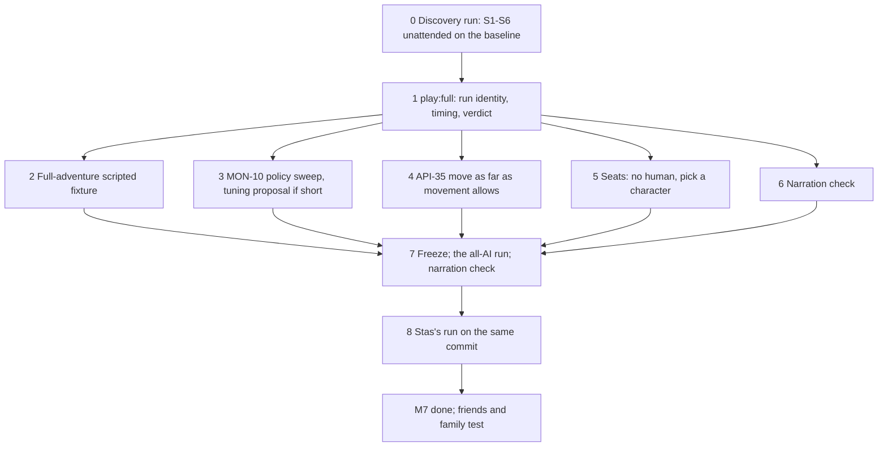

# Milestone 7: demo acceptance

- **Status:** Agreed with Stas on 2026-10-27: he dropped the three timed runs (19:59Z), answered D1 to D3 (20:04Z), picked the upload destination (20:18Z) and accepted D4 and D5 (20:53Z), §6. Nothing here is built yet.
- **Date:** 2026-10-27
- **Owner:** Stas
- **Baseline:** table main 63e1f34 (everything through table #145, plus #141 and #143), contract `1.0.0-dev.36`, core pinned at d00786a (fork `demo` after core #59). M7 validates this build and what it adds.
- **Exit criterion** (`TASKS.md` § Milestones, §3 below): one unattended run and one run with Stas in the human's seat, on one commit, each playing Scene 1 to 6 and passing the record checks. Latency is measured and reported, not gated (D1).
- **System design:** [`docs/design/demo-acceptance-system.md`](../design/demo-acceptance-system.md): components, data flow, the narration check's replay, failure modes and trade-offs.
- **Decisions:** [0043](../decisions/0043-demo-acceptance-two-runs.md) (the acceptance change), [0044](../decisions/0044-one-repo-through-m7.md) (no repo split before M7 ends), [0045](../decisions/0045-run-profiles-and-models.md) (run profiles and models). The rows are in `TASKS.md` (§9).

## 0. Decided before this note: one repo through M7

Stas asked whether to split nat20-table into a Rust API and a TS client before M7. He picked the third option on the card (2026-10-27 19:48Z): **keep one repo through M7. After M7, the Telegram milestone puts a contract on the loop-to-client line, first as a package, then as its own repo when the bot ships.**

The evidence behind it, from main:
- Since Milestone 6 began, 8 of 44 merged PRs changed both the Rust crates and `game/`. Six of them were contract changes. The other two changed engine output that the game fixtures record (option names, API-36) or the audit that reads the game's transcripts (#104). The contract went from dev.30 to dev.36 in a week, and most of those versions re-recorded game fixtures, which need the engine built. In two repos, each of those becomes two PRs plus a published engine build and a pin bump. (The decision card said all eight were contract changes; six is the right count, and the conclusion doesn't change.)
- The Rust/TS line is internal. Only our game loop talks to the engine, and that wire already has a contract, a schema hash, fixtures and a breaking-change check.
- Telegram (North Star option C) needs a different line: between the game loop and its clients. Today that line is the in-process `Seat` interface (`game/src/table/types.ts`: `TableEvent` out, `PlayerIntent` in), and `loop.ts` imports no UI code. So Telegram needs a contract on that line, a host for the loop and saved sessions. It does not need a rewrite of the loop.
- The transcript format is a second implicit contract (written by TS, read by the Rust audit). A Rust/TS split would cut through it, and through the scenario pack, which is both engine data and DM prose.

Nothing in M7 depends on this beyond "don't split". Decision 0044 records it.

## 1. Goal and non-goals

**Goal.** Validate that the whole thing works: *The Silent Mill* plays from Scene 1 to Scene 6, once with nobody at the keyboard and once with Stas in the human's seat, on the same build, and both runs pass the checks their records allow. Stas decided this on 2026-10-27 19:59Z: "I don't think we need this three runs. I will test them myself and give to friends and family. So main ideas just to validate that whole thing is working. I propose to have one autonomous run and one run from my side."

**In M7's first block, before the freeze:** party talk AGT-31..33 (done), AGT-34 background reactions in a fight (Stas, 20:08Z: R0+R1; §4.8), and AGT-38 Russian names at the table (Stas's card 19:55Z). They change round length and model calls, so they land before the runs are taken.

**Non-goals:**
- Statistical acceptance. Three timed runs in a row are dropped (Stas, above). Friends and family test after M7, and the first-time-player check (scope §6.6, AGT-13) happens there.
- Making the agents faster. Latency is recorded and reported, but the work to meet the 10 s and 6 s targets belongs to the optimisation milestone (Stas, 2026-10-27 14:01Z; D1). That includes pipelined narration (AGT-25), streaming, the DM's second model call per narration, and the DM's 12 s timeouts.
- A stand-in model typing on the human's seat. The unattended run has no human at all: every party member is an AI player (D2), and Stas's own run covers the human's path.
- New rules or new content beyond what a failing run proves is needed. A run that exposes an engine bug gets a fork or table row (Rules 4 and 5), not a workaround.
- The repo split and the client contract (§0). Monster turns by the DM (AGT-23) and memory across runs (AGT-22): both after M7.

## 2. Where we stand

What already exists and what M7 can reuse:

| Need | Today | Gap |
|---|---|---|
| Play the whole adventure in one run | `npm run play:scene -- --scenes …` plays a list of scenes with the party carried over (table #115) | Never run with all six scenes |
| Nobody at the keyboard | `--seat scripted`: fights by rule, says "I wait." out of combat, accepts a surrender. The table always has one human seat (`packParty` requires it) | A table with no human, all four characters AI players (D2, §4.2) |
| Stas in the human's seat | `--seat ink` (the exit run), always as Bren: the pack's `seat` fixes who is human | Pick a character from the list (AGT-35, Stas 20:09Z, §4.2) |
| Every roll logged and cited (scope §6.2) | `nat20-audit`: 90 of 90 cited in the latest Russian run | None |
| Nothing hidden leaks (Rule 3) | Leak scan in `nat20-audit`: 0 leaks | None |
| Narration matches engine state (§6.3) | Prompt rule (table #125) and the AGT-30 surrender flow (#143). No checker | A narration check with Opus at low effort (D3, §4.3) |
| Latency (§6.4) | `usage.jsonl` and report p50/p95 per agent | Gate only (D1) |
| Retries (§6.5) | `maxRetries` 2 per AI decision; retries and fallbacks counted in the report | A clear pass rule (§3); API-35 is the known cause of failures |
| Time (§6.1) | Wall clock only from transcript timestamps | Per-scene timing, a 120-minute stop, run identity |

What the live runs so far show (run folders in the project folder, `engine/m6/runs/`):
- **The party has won the yard in all four live runs** (ai-party, Scene 3 with the DM, the exit run, the Russian party-talk run). **No agent has ever played the cellar.** With the crude scripted driver, the party won both fights in about 41% of seeds 1 to 51 (MON-10).
- **Scenes 2, 4, 5 and 6 have never been played by the DM agent.** They load in order with the party carried (`game/test/pack.test.ts`), and the cellar fight starts. Scene 2 was passed over in every live run.
- **Time is not the risk.** The Russian run played Scene 1 in 3 min 47 s and Scene 3 in about 17 min, against targets of 10 and 25. A rough projection for all six scenes, with the cellar at 25 min, is 50 to 60 minutes against the 120-minute limit.
- **The DM times out.** It hit the 12 s limit 5 times in a 21-minute run, and each time its narration was skipped. This is latency (D1), but a timed-out `table_turn` in explore mode could also stall a scene, so the first full run has to check for that. It did: in the first full run on main (2026-10-29) a fresh scene session's first turn ran past 12 s in Scene 4, the next `table_turn` timed out too and loaded Scene 5, and the party went into the cellar without its short rest. The DM's `scene_open`, `table_turn` and `summary` wakes now get 30 s; narration keeps 12 s.
- **Run folders don't record the table commit.** The stage-1 facts for the Russian run had to infer the build.

The "gaps blocking the demo" list, checked against the code on 2026-10-27:

| Row | Finding | Proposal |
|---|---|---|
| ENG-9 rest interruption | Can't happen through the API. `short_rest` is one command, explore only, and is refused in combat (`adapter/game.rs`) | P2, note why; not an M7 gate |
| ENG-10 Second Wind on a Short Rest | `partial_recharge` (core 62bc74c) is in the pinned d00786a | Done, once a sheet or fixture shows the regained use |
| ENG-11 walk continues into combat | P2; the table never starts a fight with a walking creature | Unchanged, not an M7 gate |
| API-31 dropped action | Done (merged 2026-10-27) | Already done |
| ENG-16 two Opportunity Attacks at one point | Fixed by core #59 (test `two_creatures_whose_reach_ends_at_the_same_point_each_get_a_window`) | Done |
| MON-10 fight balance | Open, and the cellar is unmeasured | **The real blocker** (§4.4) |

The list was also missing API-35 (the cause of nearly every retry so far) and the untried scenes 2, 4, 5 and 6.

## 3. The two runs and how each is judged

### 3.1 The runs

Both runs are on Stas's Mac under his Claude subscription (decision 0036), in Russian (the table language; decision 0038), with a fresh random seed each, on the same frozen commit, and play Scene 1 to Scene 6 with `npm run play:full` (§4.1):
1. **The unattended run.** `--seat ai`: no human; Bren, Torva, Maren and Ilsa are all AI players (D2). Nobody types anything after the command starts. It goes first because it costs none of Stas's time.
2. **Stas's run.** `--seat ink`: the run starts by asking Stas which character to play, and AI players take the other three (§4.2).

Which models each run uses comes from a run profile (§4.1): the unattended run on `cheap` and Stas's run on `demo` (D4).

If either run fails, the fix makes a new commit. The unattended run is then repeated on it, since it costs no time. Stas's run is repeated only if it was the one that failed. Both passing runs must be on the same commit. An unattended run cut short by something outside the game (the plan's usage limit, the Mac sleeping or losing power, the network dropping) is void: it is run again and counts neither way. An engine crash, a model timeout that stalls the game, or a stuck scene is the product's fault and fails the run.

### 3.2 What each run is judged on

| # | Scope §6 | Measured | From | Pass |
|---|---|---|---|---|
| 1 | Scene 1 to 6 within 120 min | Wall clock from the first scene load to the end of Scene 6, per scene against `target_minutes`; for the unattended run, no keystroke and no restart | `run.json` (§4.1), transcript timestamps, `inputs.jsonl` | Scene 6 reached and the adventure ended within 120 min. `play:full` stops at 120 min as a fail |
| 1a | The party survives | Party state at the end of each fight | Session log | A total party kill fails the run. One dead character doesn't; it's reported |
| 2 | Every roll in the transcript is in the engine log | Audit | `nat20-audit` (exists) | 0 problems |
| 3 | No narration contradicts engine state | Narration check (§4.3, D3) | Transcript plus session log | 0 contradictions confirmed by Stas |
| 4 | p95 AI player ≤ 10 s, DM ≤ 6 s | p50 and p95 per agent and per kind of wake | `usage.jsonl` (exists) | Reported only (D1) |
| 5 | Every rejected human or AI decision recovers within 2 retries | Per decision: attempts, retries, and fallbacks after the retries ran out. "Rejected" means refused by the engine or by a guard. A timeout is latency, not a rejection. For the human: refusals per decision, including words the DM couldn't map; the human is never cut off | Transcript `retry` and `fallback` records | No AI player or DM fallback after its retries ran out, and no human decision refused more than twice that Stas confirms as the table's fault (design §3.3) |
| — | Rule 3: nothing hidden reaches a player | Leak scan | `nat20-audit` (exists) | 0 leaks |
| 6 | A first-time player finishes using `/options` and `/sheet` | Not in M7 | Friends-and-family runs after M7 (AGT-13) | — |

Stas's own run is also where he judges the thing as a player. Whatever he finds that isn't one of the rows above becomes a finding for his review, not an automatic fail.

### 3.3 What changes in the scope and CLAUDE.md

Scope §6 was accepted by Stas and changes only with his agreement; his message above is that agreement for these two items. The spec PR amends `docs/scope/demo-run-scope.md` §6 and CLAUDE.md's "Acceptance (scope §6)" list, and the project instructions are re-condensed after it merges:
- §6.1 "Three internal playthroughs finish from Scene 1 to Scene 6 in 120 minutes or less without manual intervention" becomes "One unattended playthrough and one played by Stas finish Scene 1 to Scene 6 in 120 minutes or less, on the same build".
- §6.6 (first-time player) stays as a goal, checked during friends-and-family testing after Milestone 7, not as M7's exit.
- §6.4 (latency) stays as a goal, gated by the optimisation milestone (D1).

Decision 0043 records the change, the dropped options (three runs in a row; three passes of any number), and when to revisit: before anyone outside friends and family plays.

## 4. Design

### 4.1 `npm run play:full`: run identity, timing and a verdict

A thin command over `play:scene` with all six scenes, `--lang ru` by default:
- `run.json` in the run folder: table commit and whether the tree was dirty, core rev, contract version, schema hash, models and efforts, language, seed, Node version, seat, and for each scene its load time, end time, `target_minutes` and rounds fought;
- a timing table in `report.md` against the targets;
- a verdict block at the top of `report.md`: `PASS`, `FAIL` with the failed rows of §3.2, or `VOID` with the cause. Criterion 3 shows the narration check's flags as "to confirm" until Stas has gone through them;
- a stop at 120 minutes, recorded as a fail;
- `caffeinate` on macOS for the length of the run, so the Mac doesn't sleep.

**Run profiles (D5).** A run's settings live in a named JSON file instead of a long command line or a Makefile:
- `game/profiles/<name>.json` holds any of the play flags under their own names, with a `_comment` saying what the profile is for:

| Profile | DM | AI players | Language | Seat | For |
|---|---|---|---|---|---|
| `cheap` | Sonnet 5.5, medium | Haiku 5.5, high | ru | `ai` | Discovery, iteration and the unattended run (D4) |
| `demo` | Opus 5.5, medium | Sonnet 5.5, low | ru | `ink` | Stas's run and showing the game |

- `--profile <name>` on `play:scene` and `play:full` loads it; a path (`--profile ~/.nat20/mine.json`) loads a personal profile that never enters the repo. Order: built-in defaults, then the profile, then flags typed on the command line (`npm run play:cheap -- --dm-model claude-opus-5-5`).
- An unknown key, a bad value, or a model missing from the price table in `usage.ts` stops the run before it starts, so a typo never costs a run. A test in `check:ts` loads every committed profile.
- `run.json` records the profile's name and sha256 and every resolved setting with where it came from (default, profile, flag). The report's first line names the profile and the models.
- Two npm aliases for the Mac: `npm run play:cheap` and `npm run play:demo` (`play:full -- --profile <name>`). A third, `npm run play:unattended`, came with decision 0046.
- Not a Makefile: it would be a second command surface on top of npm, it can't check a value or record what ran, and the repo's data is JSON with `_comment` throughout.

### 4.2 Who plays whom: any character, or nobody (D2, AGT-40, AGT-35)

Today the pack's `seat` field fixes Bren as the human and the other three as AI players. The pack schema already calls it the default ("who plays it by default"), and the table's rules already key on the human's handle, never on Bren. M7 makes the seat map a choice made at the start of a run, in two steps.

**Any character may be an AI player, and the table may have no human (AGT-40, `--seat ai`).** Every party member already has a card (`cards/bren.md` was written in M6 for this). The player prompt gets a variant for a table with no human: "A human and other AI players play the other characters" becomes "Other AI players play the other characters". With no human:
- `packParty` and `TableState` take "no human" as a case instead of an error; every party member gets a `ModelPlayer` with its own bound tools (Rule 3: Bren's agent sees only Bren's view, like any AI player);
- out of combat, a round starts from the DM's narration instead of the human's line: every AI player gets the `hand` wake, and the floor and hand-off rules are unchanged (decisions 0039, 0040), except that nobody is named by a human line;
- the DM's prompt and tools leave out the human: no `ask_human`, no human options through `submit`. A surrender is the DM's call (`end_combat` with surrender, or fight on), as when the human's character is down today (walk-on and surrender spec, D3);
- a reaction window against an ally is declined without a model call for every seat (AGT-27 already does it for AI seats);
- there is no terminal seat, so no situation panel; the transcript has no human channel; the audit and leak scan run per AI seat as now.

**The human picks a character from the list (AGT-35, Stas 20:09Z).** With `--seat ink`, the run starts with a numbered list of the party from the pack. Each entry shows the character's name, species, class and level, plus the first line of the card's Goal, so the choice reads like picking a pregen. The human picks by number, and the other three become AI players from their cards. `--play <handle>` skips the list for scripted runs and tests, and the default stays the pack's `seat` (Bren). The choice is logged in `run.json` and the transcript. Nothing changes in the engine: handles and sheets stay the same, and only the table's seat map moves. The DM's prompt already names the human's character from the seat map (`${human}`), so it follows the choice. Tests: a scripted run with the human on each of the four characters, checking that the bindings, the leak scan (the human's feed is that character's view) and the reaction auto-decline (walk-on spec D2, keyed on the human's handle) follow the choice.

### 4.3 Narration check (AGT-9, D3)

`npm run audit:narration -- <run-dir>`, run by `play:full` after the existing audit:
1. **State digest (deterministic, tested in CI).** The session log alone can't rebuild state (`scene_loaded` carries no positions; starting HP and inventory live in the pack and the pregens), so `nat20-digest` replays the run's `engine-log.jsonl` through an in-process engine, checks each response against the recorded one, and at each DM narration's `log_head` reads the replayed engine's DM view and the party's sheets. Per narration it writes: every creature in the scene with HP, life state, conditions, position, surrendered or fled; the pairs within 5 ft and each party member's distance to the nearest foe; whose turn it is and whether combat is over; the party's equipment and consumables with quantities, and coins from the pregens (the engine doesn't track money); who each character is per the pack (name forms and the new optional `pronouns`); and the engine lines since the previous narration, `item_used` included. It lives next to the audit, in `nat20-duel` (design §3.4).
2. **Judge: Opus 5.5 at low effort** (Stas, D3). It reads batches of narration lines with their digests and returns contradictions through one typed tool: line, claim, kind (HP, death, position, condition, action, surrender, inventory, identity), evidence `seq`. Inventory flags only three things: an engine-tracked item the character doesn't carry; a consumable used with no engine event, or more often than carried; and coins or an item changing hands that the sheet doesn't show. Props from a card (Maren's bread, Ilsa's notebook) and scene objects are listed as untracked, not flagged (Stas, 20:12Z; baseline: 0 contradictions on engine-tracked items and 5 of 5 potions narrated right in the three Milestone 6 runs, checked by hand on 2026-10-27). It is neither the DM nor a player, and has no way to change the game.
3. **Smoke check.** Before the M7 runs, the judge runs once on the Mac against the two real contradictions we already have: Bren narrated adjacent while the engine had him 24 ft away (exit run), and the goblin narrated as surrendering and then shooting (Russian run). It must flag both. Those runs come from an older build, so they are digested only if their engine logs still replay; a scripted fixture with the same two contradictions planted is the check that always works (design §3.4).
4. **Verdict.** The flags go into the report with their evidence; Stas confirms or dismisses each. Criterion 3 passes with zero confirmed.

CI tests the digest and the judge's plumbing with a scripted judge; CI never calls a model.

### 4.4 Fight balance (MON-10)

One unattended run can't measure balance, and friends and family shouldn't meet a party wipe in the cellar either. Target: **the party reaches Scene 6 standing in at least 90% of runs**. Measured in two layers:
- In the cloud, at no cost to Stas: a competent scripted party policy (focus the weakest foe in reach, Healing Word on a downed ally, potions at a third of HP, Second Wind and Action Surge, Rage) over at least 100 seeds. It plays the chain of Scene 2 (the snare, and the lookout check that decides the yard's surprise), Scene 3, the Scene 4 short rest and interrogation (which can warn the boss), then Scene 5 with the party carried, because attrition is the point of the cellar (design §3.6).
- On the Mac: the discovery run (step 0) and the unattended run both play the cellar with the model party. Two samples say little on their own, but they show whether the agents do clearly worse than the policy.

If the measured rate is below target, the fix is a **tuning proposal for Stas** (scenario content: the rats' trigger, the warned boss's extra warrior, one wolf fewer, a second potion, and so on). Encounter changes touch the scope's encounter table, so they are his decision, made with numbers.

### 4.5 Retries (API-35)

In the live runs so far, almost every retry, and the one AI fallback, was API-35: a move toward a target out of reach was refused whole instead of going as far as movement allows. That alone can fail criterion 5, and it is what a human player feels most. M7 takes the existing row as is (contract-first: an optional "as far as movement allows" on `move`, or a core path that stops at the limit).

### 4.6 Full-adventure scripted fixture

Scenes 1 to 6 with the scripted DM, players and seat at a fixed seed, replayed byte for byte in CI, like `m5_yard` and `m3_trail`. It guards the scene chain (transitions, the captive carried from the yard, the warned boss, the rats, the end of the adventure) against every later change, without a model.

### 4.7 Pacing (AGT-12): only if needed

The projection in §2 leaves about an hour of slack. Pacing (cutting optional content when behind) is built only if the discovery run or the policy chain projects a run above 100 minutes. Otherwise the row stays open after M7 with the measured times.

### 4.8 Background reactions in a fight (AGT-34, R1)

Designed in `docs/design/party-talk.md` §5 (decision 0039); Stas picked R0+R1 on 2026-10-27 20:08Z. On a salient event in a player's own view (an ally down or back up, a critical hit, a kill, a surrender, a hit on that player), every AI player who may react gets a one-line `bark` wake that has only `say`: conscious, not the one whose turn is next, and not the one whose own deed is the trigger. The first line wins and the others are cancelled (R1 spec D1 = B). At most one reaction line a round. The fight doesn't wait: the line shows the moment it is ready, even before the DM narrates the trigger (D2 = B), and a bark not answered within 8 s is dropped. If anything else wakes the reacting player, its own turn included, that wake waits at most 5 s, then the bark is cancelled. The speech guard checks the line, so nothing hidden reaches it (Rule 3). Cost: about $0.06-0.09 a trigger with three players eligible, at most about $0.6 a fight; no wait on the turn path.

R0, a line on the player's own combat turn, shipped in AGT-31. In the 19:06Z Russian run it gave 1 AI line in 6 fight rounds, against the party-talk goal of about 1 every 2 rounds (analysis F9). That is why R1 matters.

What's still needed, owned by the party-talk thread:
- **A short R1 spec** (project folder, `engine/m7/party-talk-r1-spec.md`), now decision 0042. It settles the two points §5 leaves open. Stas answered both on 2026-10-27: any AI player not acting next may react, first line wins (its D1 = B); and a reaction shows the moment it is ready, even before the DM narrates the trigger, outside ADR 0041's hold (its D2 = B).
- **One PR** (table #147, in review): trigger detection from each player's projected events, a cancellable background `bark` wake (the first concurrency inside an agent's session, the design's main risk), scripted players that bark deterministically so the game fixtures still replay byte for byte, and the report line for reactions per fight.
- **A Russian run on the Mac** to check the party-talk goal. The gate is that goal measured on a run, not a fixed count.

### 4.9 Runs upload themselves (AGT-41, Stas 20:15Z)

Today Stas zips each run folder on his Mac and attaches it in a thread, and a thread copies it into the project folder. Destination decided by Stas (card, 20:18Z): every play command (`play:full`, `play:scene`, `play:exit`, `play:ai-party`) ends by uploading its run folder, after the audit, to **a private repo `StGerman/nat20-runs`**:
- `runs/<run-id>/` holds the run folder as written: transcript, logs, inputs, usage, report and `run.json`. Run records still never go into nat20-table or nat20 (Stas's rule; `runs/` stays gitignored there).
- It uses plain `git` with Stas's existing login, in a local clone kept at `~/.nat20/runs-repo` (cloned on first use). It commits the folder with the run identity in the message, pushes, and prints one line: the run id, the commit and the URL, for pasting into a thread if he wants.
- `NAT20_RUNS_REPO` (or `--upload <repo>`) names the destination; `--no-upload` skips it. With neither set, the command prints how to set it up. A failed upload never fails the run. `npm run runs:upload [-- <run-dir>]` retries a failed push, sends what `runs:finish` added after the first upload, sends older runs, and skips a run whose pushed copy is already up to date (design §3.8).
- `npm run preflight` gains a check that the destination is set and reachable.
- One-time setup on Stas's side: create the private repo and add it to the Claude project's repositories, so threads can read it. Analysis threads then work from the repo and write `facts.md` and `analysis.md` to `engine/<milestone>/runs/<run-id>/` in the project folder, as now.
- Fallback with no setup: `--zip` writes `<run-id>.zip` next to the folder and opens Finder with it selected, the one-liner Stas already uses.

## 5. Steps

One PR per code step, stacked, in this order. Steps 0, 7 and 8 are runs on Stas's Mac.

First block (owned by the party-talk and run-analysis threads, landing before step 7): AGT-34 (§4.8) and AGT-38.

0. **Discovery run (no code).** `npm run play:scene -- --scenes s1_village_green,s2_mill_road,s3_mill_yard,s4_captured_goblin,s5_mill_cellar,s6_wrap_up --seat scripted --lang ru --dm-model claude-sonnet-5-5 --dm-effort medium --player-model claude-haiku-5-5 --effort high` on 63e1f34 (the `cheap` settings typed out, since profiles come with step 1), the scripted seat standing in until step 5 lands. This is the first time the DM agent plays the whole adventure. Its findings (scene transitions, the captive from the yard, the warned boss, the rats, Scene 6's ending, any stall after a DM timeout) become rows for Stas's review. Stage 1 and stage 2 analysis as for the Russian run, plus the D4 comparison with the Russian run.
1. **`play:full` (§4.1), and runs that upload themselves (§4.9).** The upload goes first, so every later run in M7, the discovery run included if it waits for it, arrives without a zip.
2. **Full-adventure fixture (§4.6).**
3. **Balance (§4.4).** The policy and the seeded chain sweep, with the win rate per fight and deaths. A tuning proposal goes to Stas if the rate is below target.
4. **API-35 (§4.5).** Contract first (Rule 1).
5. **Seats (§4.2).** a) Any character may be an AI player, and the table may have no human (AGT-40), with a scripted test of a round and a fight with four AI seats on the real loop. b) The character list at the start of `--seat ink`, and `--play` (AGT-35).
6. **Narration check (§4.3).** Digest, judge command, and the smoke check on the Mac.
7. **Freeze and the all-AI run.** Tag the candidate; `npm run play:unattended` (`--seat ai`; DM Opus 5.5 low since decision 0046, as D4 fell back). Runs go to the runs repo (AGT-41) and analyses to the project folder's `engine/m7/runs/`, never into this repo.
8. **Stas's run.** `npm run play:demo` (`--seat ink`) on the same commit, as the character he picks. Then M7 is marked done in TASKS.md.

## 6. Decisions (Stas: D1 to D3 at 2026-10-27 20:04Z, D4 and D5 at 20:53Z)

D1 to D3 are recorded in decision 0043, D4 and D5 in decision 0045.

| # | Question | Decided |
|---|---|---|
| D1 | Is latency part of M7's exit | No: measured and reported only; the optimisation milestone gates it |
| D2 | Who sits in the human's seat in the unattended run | Nobody: all four party members are AI players (§4.2) |
| D3 | How narration is checked against state | A narration check with Opus 5.5 at low effort as the judge (§4.3), not the run-analysis pipeline. Reading taken: the check is built as a command in M7, so friends-and-family runs can reuse it |
| D4 | Which models the runs use (Stas's idea, 20:18Z) | `cheap` (DM Sonnet 5.5 medium, players Haiku 5.5 high) for step 0, every iteration run and the unattended run; `demo` (DM Opus 5.5 medium, players Sonnet 5.5 low) for Stas's run. Step 0 is compared with the Russian run on retries, guard refusals, DM timeouts, talk metrics and, once step 6 lands, narration flags. If the Sonnet DM does clearly worse, the DM goes back to Opus and the players stay on Haiku, which is where most of the saving is (below) |
| D5 | How run settings are kept | JSON run profiles with `--profile`, not a Makefile (§4.1) |

What D4 saves, priced from the Russian run's `usage.jsonl` (21 minutes, Scenes 1 and 3; API-equivalent dollars from the price table in `usage.ts`; on the subscription this is plan usage, not money):

| Setup | DM | Players | Run | Saving |
|---|---|---|---|---|
| Today: Opus medium + Sonnet low | $2.31 | $2.18 | $4.49 | |
| Opus DM + Haiku players | $2.31 | $0.11 | $2.42 | 46% |
| `cheap`: Sonnet DM + Haiku players | $1.90 | $0.11 | $2.01 | 55% |

The Sonnet DM saves only 18% of the DM's cost, because 7.4M of its tokens are cache reads, priced $0.20 per million on Opus 5.5 and Sonnet 5.5 alike. The DM's real cost driver is context size times calls, which is the optimisation milestone's work. Haiku at high effort thinks more, but its output costs $0.50 per million, so that is cents; it adds latency, which is reported only (D1).

## 7. What the Russian run analysis feeds in

The stage-2 analysis of run `scene-2026-10-27T19-06-55-414Z` has produced AGT-38 (Russian names, now in M7's first block). Stage 1 facts already shape this note: the 5 DM timeouts (§2, D1), the surrender narrated with no engine command (which #143 should now prevent; step 0 checks it), the missing table commit (§4.1), and party talk on target (33% silent, round p95 15.9 s). Any further finding that touches criterion 1, 3 or 5 becomes a proposed M7 row in `TASKS.md`, for Stas's review. Talk-quality findings stay with the party-talk thread.

## 8. Risks

1. **The cellar is unplayed.** It is the most likely reason for a failed run. Steps 0 and 3 come first for that reason.
2. **Plan usage limits.** A full run is roughly three times the 21-minute run's model use, and the all-AI run adds a fourth player agent plus the Opus judge. The `cheap` profile roughly halves it (D4). A limit stop is a void, not a fail; run it in a fresh usage window.
3. **DM timeouts.** They skip narration (latency, D1). If step 0 shows one stalling a scene, that becomes a correctness row in M7.
4. **Two runs prove it works, not that it works every time.** Friends and family are the next filter; a crash there is a row, not a reopened M7.
5. **No Dodge (ENG-19).** A player asking to "take cover" gets nothing to map to. It stays a P1 fork row and isn't an M7 gate unless step 0 or Stas's run shows it blocking.
6. **Haiku players in Russian.** Haiku 5.5 hasn't played at this table. The speech guards (no digits, no stat terms), the hand-raise answer format and staying in character are where it can slip; each slip is a retry, which criterion 5 counts. Step 0 measures it before anything depends on it.

## 9. TASKS.md changes (written 2026-10-27)

| ID | Change | Pri | Dest | Size | Status |
|---|---|---|---|---|---|
| M7 row | Exit criterion per §3 (one all-AI run on `cheap` and one by Stas on `demo`, same commit, Scene 1 to 6 within 120 min, audit, leak scan, narration check, retries, no total party kill; latency reported); first block AGT-31..34 and AGT-38, all before the freeze; then AGT-14, AGT-41, AGT-39, MON-10, API-35, AGT-40, AGT-35, AGT-9, AGT-12 (conditional) | | | | todo |
| AGT-14 | M7 scope: `npm run play:full` with run identity, per-scene timing, verdict block, 120-min stop, voids, `caffeinate`, and run profiles (`--profile`, `cheap` and `demo`, `play:cheap`, `play:demo`; D5) (§4.1). Drops "three unattended playthroughs" | P0 | Ours | M | partial |
| AGT-39 (new) | Full-adventure game fixture: Scenes 1 to 6 with the scripted DM, players and seat, seeded, replayed in CI (§4.6) | P1 | Ours | S | todo |
| AGT-40 (new) | Any character may be an AI player, and a table may have no human: `--seat ai` plays every party member as an AI player from its card; rounds start from the DM's narration; the DM decides surrenders (§4.2, D2) | P1 | Ours | M | todo |
| AGT-9 | Narration check: deterministic digest (state, inventory, card identity) plus an Opus 5.5 low-effort judge, smoke-checked on the two known contradictions; flags confirmed by Stas (§4.3, D3) | P1 | Ours | M | todo |
| MON-10 | Target: the party reaches Scene 6 standing in ≥ 90% of runs; competent policy chain sweep over ≥ 100 seeds; tuning proposal to Stas if short (§4.4) | P1 | Ours | M | todo |
| API-35 | Pulled into M7 as is (§4.5) | P1 | Ours | S | todo |
| AGT-12 | Built only if a run projects above 100 min (§4.7) | P1 | Ours | S | todo (conditional) |
| AGT-13 | Moves to friends-and-family testing after M7 | P1 | Ours | S | partial |
| AGT-10 | Recording stays; the latency gate moves to the optimisation milestone (D1) | P1 | Ours | S | partial |
| AGT-25 | Moves to the optimisation milestone | P1 | Ours | S | todo |
| AGT-41 (new) | Runs upload themselves: every play command pushes its run folder to the private runs repo after the audit; `runs:upload` retries or sends old runs; preflight checks the destination; `--zip` fallback (§4.9) | P1 | Ours | S | todo |
| AGT-34 | In M7's first block (Stas 20:08Z, R0+R1; decision 0042); gate: the party-talk goal on a run (§4.8) | P2 to P1 | Ours | M | partial: table #147 in review |
| AGT-35 | Into M7 (Stas 20:09Z): at the start of `--seat ink` the human picks a character from the party list, and the rest become AI players; `--play <handle>`; builds on AGT-40 (§4.2) | P2 to P1 | Ours | S | todo |
| ENG-9 | P1 to P2: can't happen through the API (§2) | P2 | Fork | S | todo |
| ENG-10 | Done: core 62bc74c is in the pin, once a sheet or fixture shows it | P1 | Fork | S | done |
| ENG-16 | Done by core #59 (§2) | P1 | Fork | S | done |
